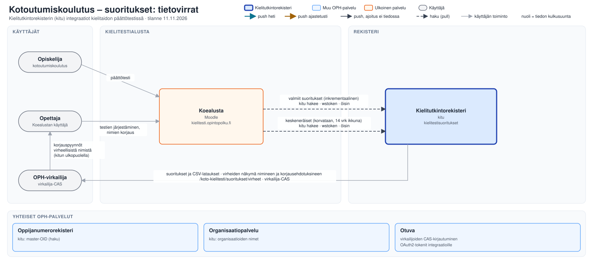

# Kotoutumiskoulutuksen päättötesti ja virheidenkäsittely

| Agenda                                    |
| ----------------------------------------- |
| 1. Mikä päättötesti on ja kuka tekee mitä |
| 2. Sanasto                                |
| 3. Suorituksen ja virheen elinkaari       |
| 4. Tekninen yleiskuva                     |
| 5. Ansat ja päätökset                     |
| 6. Ylläpito                               |
| 7. Kokeile itse (demo)                    |
| Kysymykset                                |
| 8. Lisälukemista (ei käydä läpi)          |

## 1. Mikä päättötesti on ja kuka tekee mitä

Kotoutumiskoulutuksen lopuksi opiskelija tekee kielitaidon päättötestin, joka mittaa suomen tai
ruotsin kielen taitoa neljällä osa-alueella. Testi tehdään oppilaitoksessa Koealustalla, joka on
Moodle-pohjainen verkkopalvelu. Kielitutkintorekisteri on testisuoritusten **rekisteri**: se hakee
suoritukset Koealustalta kerran yössä, tunnistaa henkilön Oppijanumerorekisteristä ja näyttää
suoritukset OPH:n virkailijoille.

### Testin rakenne

- **Kieli:** suomi tai ruotsi (`Testikieli`).
- **Osa-alueet:** luetun ymmärtäminen, kuullun ymmärtäminen, puhuminen ja kirjoittaminen. Jokainen
  arvioidaan erikseen.
- **Arvosanat:** `Alle A1`, `A1`, `A2`, `B1`, `Yli B1` ja `EVA` (ei voi arvioida) (`Arvosana`).
- **Kurssi:** Koealustan kurssi, jolla testi tehdään. Kurssi kuuluu yhdelle oppilaitokselle ja
  sillä on opettaja.

Yksi **suoritus** on yhden henkilön yksi testikerta yhdellä kurssilla: suoritusaika, kieli ja
neljä arvosanaa.

### Kuka tekee mitä

| Osapuoli               | Rooli                                                                                                                                       |
| ---------------------- | ------------------------------------------------------------------------------------------------------------------------------------------- |
| Opiskelija             | Tekee testin Koealustalla.                                                                                                                  |
| Oppilaitos ja opettaja | Järjestää testin ja kirjaa opiskelijan tiedot Koealustalle. Korjaa virheelliset henkilötiedot.                                              |
| Koealusta              | Moodle-pohjainen verkkopalvelu, jossa testit tehdään ja arvioidaan. **Kielitutkintorekisterin ainoa päättötestisuoritusten lähde.**         |
| Kielitutkintorekisteri | Rekisteri. Hakee suoritukset Koealustalta, hakee henkilölle oppijanumeron ja kirjaa virheeksi sen, mitä ei voi tallentaa.                   |
| OPH-virkailija         | Selaa suorituksia, lataa CSV-raportteja ja seuraa tuonnin virheitä. Pyytää oppilaitosta korjaamaan tiedot, joiden takia tuonti epäonnistuu. |
| Oppijanumerorekisteri  | Henkilöiden tunnisteet. Kielitutkintorekisteri hakee sieltä oppijanumeron henkilötunnuksella ja nimillä.                                    |

[](https://raw.githubusercontent.com/Opetushallitus/kielitutkintorekisteri/refs/heads/main/docs/technical/kaaviot/kotoutumiskoulutus-suoritukset.svg)

Kolme asiaa, jotka erottavat tämän YKI-suorituksista:

- **Kielitutkintorekisteri pyytää datan Koealustalta.** Tietoja ei työnnetä. Kaikki tapahtuu yöllisessä eräajossa.
- **Suoritukset eivät lähde eteenpäin.** Niitä ei siirretä KOSKI-järjestelmään eikä muualle.
- **Henkilö tunnistetaan Kielitutkintorekisterissä.** Koealusta tuntee henkilön nimen ja
  henkilötunnuksen, ei oppijanumeroa. Jos Oppijanumerorekisteri ei tunnista henkilöä näillä
  tiedoilla, suoritusta ei voi tallentaa. Tästä syntyy suurin osa tuonnin virheistä, ja siksi
  virheidenkäsittely on puolet tästä aiheesta. Henkilötiedot tarkistetaan jo kurssille
  ilmoittautuneelta, jotta virhe ehditään korjata ennen kuin testi valmistuu. Noin 2% siirroista epäonnistuu virheellisten henkilötietojen takia.

## 2. Sanasto

| Termi                | Merkitys                                                                                                                                                            | Koodissa                                                          |
| -------------------- | ------------------------------------------------------------------------------------------------------------------------------------------------------------------- | ----------------------------------------------------------------- |
| Koealusta            | Moodle, josta suoritukset haetaan. Koodissa myös "Moodle".                                                                                                          | paketti `kotoutumiskoulutus/koealusta/`                           |
| Kielitesti           | Päättötestin nimi koodissa ja osoitteissa.                                                                                                                          | `Kielitesti*`-luokat, `/koto-kielitesti`                          |
| Suoritus             | Yhden henkilön yksi testikerta yhdellä kurssilla.                                                                                                                   | `KielitestiSuoritus`, taulu `koto_suoritus`                       |
| Valmis suoritus      | Testi on tehty ja arvioitu: suorituksella on arvosanat, suoritusaika ja oppijanumero.                                                                               | `completed = true`                                                |
| Keskeneräinen        | Henkilö on ilmoittautunut kurssille, mutta suoritus ei ole valmis. Ei arvosanoja eikä suoritusaikaa. Oppijanumero on, jos Oppijanumerorekisteri tunnistaa henkilön. | `completed = false`                                               |
| Kurssi               | Koealustan kurssi. Suoritus tunnistetaan kurssin tunnisteella, oppijanumerolla ja suoritusajalla.                                                                   | `kurssiId`, `kurssi`                                              |
| Oppilaitos           | Kurssin järjestäjä organisaation OID:na. Nimi haetaan organisaatiopalvelusta.                                                                                       | `oppilaitosOid`, Koealustan kenttä `schoolOID`                    |
| Tehtäväpaketti       | Tehtäväpankin versio, jolla testi tehtiin.                                                                                                                          | `tehtavapaketti`, Koealustan kenttä `questionbank_release`        |
| Oppijanumeron haku   | Kutsu Oppijanumerorekisteriin henkilötunnuksella, etunimillä, kutsumanimellä ja sukunimellä. Onnistuu vain, jos tiedot vastaavat rekisterin tietoja.                | `OppijanumeroService.getMasterOid(Oppija)`                        |
| Tuontivirhe          | Suoritus tai tietue, jota ei voitu tallentaa, ja syy.                                                                                                               | `KielitestiSuoritusError`, taulu `koto_suoritus_error`            |
| Ratkaisuehdotus      | Virheen yhteyteen laskettu ehdotus siitä, miten nimet pitäisi korjata Koealustalle.                                                                                 | `OppijanumeroRatkaisuehdotus`, sarakkeet `onr_*`                  |
| Vesileima            | Hetki, josta alkaen seuraava ajo hakee valmiit suoritukset. Eräajon oma tila.                                                                                       | `importValmiitSuoritukset(from)`, Koealustan parametri `from`     |
| Ilmoittautumisikkuna | Kuinka vanhoja ilmoittautumisia keskeneräisten haku ottaa mukaan.                                                                                                   | `kitu.kotoutumiskoulutus.koealusta.keskeneraiset.enrolmentWindow` |

## 3. Suorituksen ja virheen elinkaari

### Valmis suoritus

Yöllinen eräajo kysyy Koealustalta suoritukset, jotka ovat valmistuneet vesileiman jälkeen. Vastaus
on lista henkilöitä, ja jokaisella on yksi tai useampi suoritus. Jokaiselle tietueelle tapahtuu
jokin näistä:

| Tilanne                                                          | Mitä tapahtuu                                                         |
| ---------------------------------------------------------------- | --------------------------------------------------------------------- |
| Tiedot ovat kunnossa ja Oppijanumerorekisteri tunnistaa henkilön | Suoritus tallennetaan oppijanumerolla.                                |
| Sama suoritus on jo tallennettu samoilla tiedoilla               | Ei tehdä mitään.                                                      |
| Sama suoritus on tallennettu, mutta tiedot ovat muuttuneet       | Tallennetaan uusi rivi. Lista näyttää uusimman.                       |
| Henkilötunnus tai kutsumanimi puuttuu                            | Virhe. Henkilön yhtäkään suoritusta ei tallenneta.                    |
| Oppijanumerorekisteri ei tunnista henkilöä                       | Virhe ja ratkaisuehdotus. Henkilön yhtäkään suoritusta ei tallenneta. |
| Suorituksesta puuttuu arvosana tai kieli, tai arvo on tuntematon | Virhe. Vain tämä suoritus jää tallentamatta.                          |
| Suorituksen oppilaitos on testioppilaitos tai oppilaitos puuttuu | Suoritus ohitetaan ilman virhettä.                                    |

Tallennettu suoritus ei muutu eikä poistu. Suorituksia ei lähetetä mihinkään.

### Vesileima

Vesileima on se, mikä tekee hausta inkrementaalisen ja virheistä itsestään korjautuvia:

- **Virheetön ajo** siirtää vesileiman uusimman haetun suorituksen suoritusaikaan.
- **Ajo, jossa oli virheitä,** siirtää vesileiman sekuntia ennen varhaisinta epäonnistunutta
  suoritusta. Seuraava ajo hakee siis epäonnistuneen suorituksen uudelleen, ja niin jatkuu joka
  yö, kunnes tiedot on korjattu Koealustalle tai Oppijanumerorekisteriin.
- Vesileima ei koskaan siirry taaksepäin.

Samalla haetaan uudelleen myös ne onnistuneet suoritukset, jotka ovat valmistuneet epäonnistuneen
jälkeen. Niistä ei synny kaksoiskappaleita, koska jo tallennettu suoritus tunnistetaan.

### Virhe

Virheet eivät ole loki vaan **tilannekuva**: virhenäkymässä on täsmälleen ne virheet, jotka
viimeisin ajo näki.

1. **Syntyy,** kun tietuetta tai suoritusta ei voi tallentaa. Virheelle kirjataan henkilön tiedot,
   kurssi, oppilaitos, opettajan sähköpostiosoite, virheviesti ja luontiaika.
2. **Toistuu** jokaisessa ajossa niin kauan kuin syy on olemassa. Sama virhe säilyttää luontiaikansa,
   joten virkailija näkee, kuinka kauan se on ollut auki.
3. **Poistuu,** kun ajo ei enää kohtaa sitä: tiedot on korjattu ja suoritus tallentui.

Virkailija ei kuittaa eikä poista virheitä. Korjaus tehdään aina lähteeseen: oppilaitos korjaa
nimet tai henkilötunnuksen Koealustalle, tai henkilön tiedot korjataan Oppijanumerorekisteriin.

### Virhetyypit

| Virheviesti                             | Syy                                                                            | Koskee                      |
| --------------------------------------- | ------------------------------------------------------------------------------ | --------------------------- |
| Puuttuva kenttä "SSN" / "preferredname" | Koealustalla ei ole henkilötunnusta tai kutsumanimeä.                          | henkilön kaikki suoritukset |
| Oppijanumeron haku epäonnistui: …       | Oppijanumerorekisteri ei tunnista henkilöä annetuilla tiedoilla tai ei vastaa. | henkilön kaikki suoritukset |
| Puuttuva arvosana "…" kurssilla "…"     | Jonkin osa-alueen arvosana puuttuu.                                            | yksi suoritus               |
| Puuttuva kenttä "lang"                  | Suorituksella ei ole kieltä.                                                   | yksi suoritus               |
| Virheellinen arvo "…" kentässä "…"      | Tuntematon arvosana tai kieli, tai oppilaitoksen OID ei ole OID.               | yksi suoritus               |

Keskeneräisten haussa syntyy vain kahdenlaisia virheitä: oppijanumeron haku epäonnistui tai
oppilaitoksen OID on virheellinen. Virhenäkymän sarake "Valmis" kertoo, kummasta hausta virhe on.

### Ratkaisuehdotus

Kun Oppijanumerorekisteri hylkää henkilön tiedot (vastaus 400, 404 tai 409), tyypillinen syy on
nimissä: kutsumanimi ei ole yksi etunimistä, etu- ja sukunimi ovat vaihtaneet paikkaa tai nimessä
on kirjoitusvirhe. Kielitutkintorekisteri yrittää selvittää oikean muodon valmiiksi ja näyttää sen
virheen vieressä:

1. Kokeilee jokaista etunimeä kutsumanimenä, sitten samaa etu- ja sukunimi vaihdettuina.
2. Hakee henkilön pelkällä henkilötunnuksella. Jos löytyy ja nimet muistuttavat Koealustan nimiä,
   ehdotus on Oppijanumerorekisterin nimet. Jos nimet eivät muistuta toisiaan, viesti kehottaa
   tarkistamaan henkilötunnuksen, koska se kuuluu luultavasti toiselle henkilölle.
3. Kokeilee nimien kaikkia järjestyksiä ja jakoja etu- ja sukunimiin.
4. Jos mikään ei tuota tulosta, viesti kertoo sen.

Muunlaisen virheen (esimerkiksi Oppijanumerorekisterin käyttökatkon) ratkaisuehdotus toteaa vain,
ettei virhe viittaa nimitietoihin.

### Keskeneräinen suoritus

Keskeneräisten haun tarkoitus on **ennakkotarkistus**: virheelliset nimet tai henkilötunnus
huomataan, kun opiskelija on vasta ilmoittautunut kurssille ja oppilaitos tavoittaa hänet
helposti. Jos virhe huomattaisiin vasta valmiin suorituksen tuonnissa, opiskelija voi olla jo
lähtenyt koulutuksesta.

Keskeneräiset haetaan omalla eräajollaan samaan aikaan kuin valmiit. Jokaiselle henkilölle
haetaan oppijanumero samalla tavalla kuin valmiille suoritukselle:

| Tilanne                                                      | Mitä tapahtuu                                                             |
| ------------------------------------------------------------ | ------------------------------------------------------------------------- |
| Oppijanumerorekisteri tunnistaa henkilön                     | Keskeneräinen tallennetaan oppijanumerolla.                               |
| Oppijanumerorekisteri ei tunnista henkilöä                   | Virhe ja ratkaisuehdotus. Keskeneräinen tallennetaan ilman oppijanumeroa. |
| Henkilötunnus tai jokin nimistä puuttuu                      | Henkilö ohitetaan ilman virhettä.                                         |
| Kurssin oppilaitos on testioppilaitos tai oppilaitos puuttuu | Kurssi ohitetaan ilman virhettä.                                          |

Keskeneräiset eivät kerry vaan **korvataan kokonaan**: ajo poistaa kaikki keskeneräiset ja
tallentaa tilalle ne, jotka Koealusta sillä hetkellä palauttaa. Samoin keskeneräisten virheet
vastaavat aina viimeisintä ajoa. Haku rajataan ilmoittautumisikkunalla (oletus 14 päivää), joten
sitä vanhempi ilmoittautuminen ja sen virhe katoavat seuraavassa ajossa. Kun testi valmistuu, se
tulee valmiiden haussa valmiina suorituksena, ja keskeneräinen rivi katoaa, kun Koealusta ei enää
palauta sitä.

## 4. Tekninen yleiskuva

Koodi on paketissa `kotoutumiskoulutus/`:

- `kotoutumiskoulutus/` — virkailijan sivut ja CSV-lataukset (controllerit)
- `kotoutumiskoulutus/koealusta/` — haku Koealustalta, validointi ja muunnos
- `kotoutumiskoulutus/suoritukset/` — suorituksen entiteetti, kyselyt ja sivut
- `kotoutumiskoulutus/suoritukset/error/` — tuontivirheet
- `oppijanumero/` — Oppijanumerorekisterin kutsut ja ratkaisuehdotuksen laskenta

Alipaketti `kotoutumiskoulutus/koealusta/tehtavapankki/` on oma aiheensa (tutoriaali 5).

### Taulut

| Taulu                 | Sisältö                                                              |
| --------------------- | -------------------------------------------------------------------- |
| `koto_suoritus`       | Valmiit ja keskeneräiset suoritukset. Sarake `completed` erottaa ne. |
| `koto_suoritus_error` | Viimeisimmän ajon virheet. `completed` kertoo, kumman ajon virhe on. |
| `scheduled_tasks`     | db-schedulerin taulu. Valmiiden haun rivin `task_data` on vesileima. |

`koto_suoritus`-taulussa valmis suoritus tunnistetaan kolmikolla `kurssi_id`, `oppijanumero` ja
`suoritusaika`. Muuttunut suoritus on uusi rivi samalla kolmikolla. Keskeneräisellä suoritusaika on tyhjä, joten
jokainen keskeneräinen on oma rivinsä.

### Koealustan rajapinta

Molemmat haut ovat `GET {baseurl}/webservice/rest/server.php`, ja funktio valitaan parametrilla
`wsfunction`. Tunnistautuminen on parametri `wstoken`.

| Funktio                                                      | Parametri      | Palauttaa                                      |
| ------------------------------------------------------------ | -------------- | ---------------------------------------------- |
| `local_completion_export_get_completions`                    | `from`         | Henkilöt ja heidän valmiit suorituksensa       |
| `local_completion_export_get_incomplete_course_participants` | `enrolledfrom` | Henkilöt ja kurssit, joilla suoritus on kesken |

Kaikki aikaleimat ovat sekunteja epochista. Vastauksen rakenne on luokissa
`KoealustaSuorituksetResponse` ja `KoealustaKeskeneraisetResponse`. Moodle vastaa myös virheeseen
tilalla 200, jolloin runko on virheilmoitus (`MoodleErrorMessage`).

### Näkymät

Virkailijalle (`KielitestiViewController`, CAS-kirjautuminen):

| Reitti                                 | Sivu                                    |
| -------------------------------------- | --------------------------------------- |
| `/koto-kielitesti/suoritukset`         | Lista: haku, rajaus, järjestys, sivutus |
| `/koto-kielitesti/suoritukset/{id}`    | Yhden suorituksen tietosivu             |
| `/koto-kielitesti/suoritukset/virheet` | Tuonnin virheet ja ratkaisuehdotukset   |

Listalla ja virhenäkymällä on CSV-lataus (`KielitestiApiController`): `GET
/koto-kielitesti/api/suoritukset` ja `GET /koto-kielitesti/api/suoritukset/virheet`. Etusivun
kortti näyttää suoritusten määrän, viimeisimmän saapumisajan ja virheiden määrän.

### Eräajot

| Eräajo                                              | Aikataulu (tuotanto) | Asetus                                                         |
| --------------------------------------------------- | -------------------- | -------------------------------------------------------------- |
| Hae kotoutumiskoulutuksen kielitaidon päättötestit  | öisin klo 1.00       | `kitu.kotoutumiskoulutus.koealusta.scheduling.import.schedule` |
| Hae kotoutumiskoulutuksen keskeneräiset suoritukset | öisin klo 1.00       | sama asetus                                                    |

Molemmat ovat luokassa `KoealustaScheduledTasks`, ja ne kytketään päälle asetuksella
`kitu.kotoutumiskoulutus.koealusta.scheduling.enabled`.

### Käyttöoikeudet ja salaisuudet

Kaikki sivut ja CSV-lataukset vaativat virkailijan `READ`-oikeuden. Koneille tarkoitettua
rajapintaa ei ole. Koealustan `wstoken` on AWS Secrets Managerin salaisuus `kielitesti-token`,
ja Oppijanumerorekisteriä kutsutaan Kielitutkintorekisterin palvelukäyttäjällä.

## 5. Ansat ja päätökset

Jokaisesta kohdasta kerrotaan, mitä ei saa rikkoa ja miksi.

### Epäonnistunut suoritus pysyy hakuikkunassa

- **Sääntö:** kun ajossa on virheitä, vesileima jää sekuntia ennen varhaisinta epäonnistunutta
  suoritusta. Älä siirrä sitä virheen ohi.
- **Miksi:** virhetaulu on tilannekuva siitä, mitä ajo näki. Jos epäonnistunut suoritus jäisi
  hakuikkunan ulkopuolelle, seuraava ajo ei näkisi sitä, virhe poistuisi korjaantumatta ja
  suoritus jäisi pysyvästi tuomatta. Sekunti on varmuusvara, koska ei ole tiedossa, sisältääkö
  Koealustan `from` rajahetken.

### Virheen tunniste on henkilötunnus ja viesti

- **Sääntö:** `KielitestiErrorService.syncErrors` tunnistaa virheen samaksi henkilötunnuksesta ja
  virheviestistä. Älä lisää tunnisteeseen muita kenttiä.
- **Miksi:** tunnisteen varassa virhe säilyttää luontiaikansa ajosta toiseen. Lisätiedot
  sisältävät Oppijanumerorekisterin vastauksen aikaleiman, ja kurssin tiedot lisättiin virheelle
  myöhemmin, joten kumpikin tunnisteessa nollaisi luontiajat.

### Toistuvan virheen vianetsintää ei ajeta uudelleen, mutta oppijanumero haetaan joka kerta

- **Sääntö:** korjaamaton henkilötietovirhe kohdataan joka yö. Jokainen ajo tekee silloin yhden
  oppijanumeron haun. Jos vastaus on sama kuin kirjatulla virheellä ja nimet Koealustalla ovat
  ennallaan, kirjattu ratkaisuehdotus käytetään uudelleen eikä vianetsintää ajeta. Älä poista tuota
  yhtä hakua.
- **Miksi:** vianetsintä kokeilee nimiyhdistelmiä ja tekee kymmeniä kutsuja henkilöä kohden.
  Yhtä hakua ei silti voi jättää pois: muuten Oppijanumerorekisteriin korjattu henkilö jäisi
  virhenäkymään, koska Koealustan tiedot eivät muuttuneet.

### Jo tallennetusta suorituksesta ei kirjata virhettä

- **Sääntö:** kun oppijanumeron haku epäonnistuu, tarkistetaan ensin, onko tietueen jokainen
  suoritus jo tallennettu saman henkilötunnuksen henkilölle. Jos on, virhettä ei kirjata.
- **Miksi:** virheen jälkeen valmistuneet suoritukset haetaan joka yö uudelleen. Jos henkilön
  nimi muuttuu Koealustalla tallennuksen jälkeen, haku epäonnistuisi suoritukselle, joka on jo
  rekisterissä, ja virkailija saisi aiheettoman virheen.

### Keskeneräisen henkilötiedot tarkistetaan

- **Sääntö:** keskeneräiselle tehdään sama oppijanumeron haku kuin valmiille, ja epäonnistunut haku
  kirjataan virheeksi. Älä poista hakua, vaikka keskeneräinen tallennettaisiin ilman sitäkin.
- **Miksi:** keskeneräisten haku on olemassa juuri tätä varten: virheelliset tiedot korjataan,
  kun opiskelija on vielä koulutuksessa. Keskeneräisten tuonti ei tehnyt hakua lainkaan
  ensimmäisinä kuukausinaan, jolloin nimivirheet näkyivät vasta valmiin suorituksen tuonnissa.

### Keskeneräisten ikkuna on samalla säilytysaika

- **Sääntö:** keskeneräiset korvataan joka ajossa kokonaan, eikä niille ole erillistä
  säilytysaikaa. Asetuksen `…keskeneraiset.enrolmentWindow` muutos muuttaa siis myös sitä, kuinka
  kauan keskeneräinen näkyy.
- **Miksi:** keskeneräisellä ei ole pysyvää tunnistetta, johon päivityksen voisi kohdistaa.
  Tyhjä arvo jättää rajauksen pois ja hakee kaikki keskeneräiset.

### Aikaleimat ovat sekunteja ja lasketaan hetkestä, ei päivästä

- **Sääntö:** Koealustalle lähetettävä aikaraja lasketaan `TimeService.now()`:sta ja muunnetaan
  sekunneiksi. Älä laske sitä päivämäärästä.
- **Miksi:** sovelluksen päivä on Suomen aikaa ja palvelimet ovat UTC:ssä, joten päivämäärästä
  laskettu raja heittää tunteja ja vaihtuu väärään aikaan.

### Oppilaitoksen ohitus koskee yhtä suoritusta

- **Sääntö:** testioppilaitoksen (`ignoredSchoolOids`) tai oppilaitosta vailla oleva suoritus
  ohitetaan hiljaa, mutta vain se suoritus. OID, joka ei ole OID, on virhe eikä ohitus.
- **Miksi:** aiemmin henkilön ensimmäisen suorituksen oppilaitos ratkaisi koko tietueen, jolloin
  yksi testikurssi pudotti henkilön oikeatkin suoritukset ilman jälkeä.

### Koealustan tunniste kulkee osoitteessa

- **Sääntö:** `wstoken` on kyselyparametri, joten se on jokaisessa pyynnön osoitteessa. Älä kirjaa
  osoitetta lokiin äläkä jäljitysspaniin sellaisenaan.
- **Miksi:** jäljitystiedot viedään AWS:ään. `SalaisuudetPiilottavaSpanExporter` korvaa
  tunnisteen arvon ennen vientiä.

### CSV-sarakkeet ovat sopimus

- **Sääntö:** älä nimeä uudelleen, poista tai siirrä `CSV_EXPORT`-saraketta enumeissa
  `KielitestiSuoritusColumn` ja `KielitestiSuoritusErrorColumn`. Uusi sarake lisätään loppuun.
- **Miksi:** virkailijoiden taulukkolaskentapohjat nojaavat sarakkeiden nimiin ja järjestykseen.

## 6. Ylläpito

Yleinen ylläpito (lokit, hälytykset, deploy) on sivulla
[Ylläpito ja havainnointi](../technical/yllapito.md). Tässä on vain päättötestiä koskeva osa.

### Mistä näkee, mitä tapahtuu

| Mitä haluat tietää                        | Mistä                                                                                                      |
| ----------------------------------------- | ---------------------------------------------------------------------------------------------------------- |
| Onko yöajo mennyt läpi                    | db-schedulerin käyttöliittymä `/db-scheduler`: viimeisin ajo, seuraava ajo ja historia                     |
| Milloin suorituksia on viimeksi saapunut  | Etusivun kortti "Kotoutumiskoulutuksen kielitaidon päättötesti"                                            |
| Mitä jäi tuomatta ja miksi                | Virhenäkymä `/koto-kielitesti/suoritukset/virheet`, linkki myös listan yläosassa                           |
| Mitä Oppijanumerorekisteri vastasi        | Virheen "Näytä lisätiedot"                                                                                 |
| Montako suoritusta ja virhettä ajo tuotti | Jäljitysspanit `koealusta.import.suoritukset` ja `koealusta.import.keskeneraiset`, attribuutit `db.saved*` |
| Mitä Koealustalta kysyttiin               | Samojen spanien attribuutit `function` ja `from` tai `enrolledfrom`                                        |

### Tavalliset tukipyynnöt

- **"Opiskelijan suoritus ei näy rekisterissä."** Hae virhenäkymästä henkilötunnuksella tai
  nimellä. Jos virhe löytyy, ratkaisuehdotus kertoo, mitä Koealustalle pitää korjata, ja rivillä
  on oppilaitos ja opettajan sähköpostiosoite. Korjauksen jälkeen suoritus tulee seuraavassa
  yöajossa, ja ajon voi käynnistää myös käsin.
- **"Virhe ei poistu, vaikka tiedot korjattiin."** Tarkista virheen lisätiedoista, millä tiedoilla
  haku tehtiin viimeksi: korjaus ei ehkä ole tallentunut Koealustalle, tai virheviesti on
  vaihtunut toiseksi.
- **"Virhe opiskelijalle, joka ei ole vielä tehnyt testiä."** Virhe on keskeneräisten hausta
  (sarake "Valmis": ei). Se on tarkoituksellinen ennakkovaroitus: kun oppilaitos korjaa tiedot
  Koealustalle, virhe poistuu seuraavassa ajossa.
- **"Virheitä on yhtäkkiä paljon."** Jos jokaisen viesti on sama eikä viittaa nimiin,
  Oppijanumerorekisteri ei ole vastannut ajon aikana. Seuraava ajo korjaa tilanteen, koska
  vesileima jäi virheiden kohdalle.

### Ajo käsin

Kumman tahansa ajon voi käynnistää db-schedulerin käyttöliittymästä. Valmiiden haku jatkaa
tallennetusta vesileimasta, joten käsin käynnistetty ajo tekee saman kuin seuraava yöajo tekisi.
Vesileimaa ei tarvitse hoitaa käsin: se on eräajon omaa tilaa, ja virheen jälkeen se jää
itsestään oikeaan kohtaan.

### Koealustan tunnisteen vaihto

`wstoken` vaihdetaan AWS Secrets Managerin salaisuuteen `kielitesti-token` jokaisella tilillä
erikseen, ja palvelu on käynnistettävä uudelleen, jotta uusi arvo tulee käyttöön. Jos tunniste on
väärä, Moodle vastaa virheilmoituksella ja molemmat ajot epäonnistuvat.

## 7. Kokeile itse

Harjoitus ajetaan paikallisesti ilman AWS-tunnuksia ja ilman Koealustaa. Koealustan virkaa hoitaa
yksi JSON-tiedosto, jota tarjoillaan Pythonin HTTP-palvelimella. Siinä näkyy koko ketju: tuonti,
kaksi erilaista virhettä, ratkaisuehdotus, virheen korjaantuminen ja vesileima.

### Vale-Koealusta

```shell
mkdir -p /tmp/koealusta/webservice/rest
cp docs/perehdytys/esimerkit/koealusta-vastaus.json /tmp/koealusta/webservice/rest/server.php
python3 -m http.server 9999 -d /tmp/koealusta
```

Palvelin vastaa samalla tiedostolla molempiin hakuihin eikä välitä parametreista: se palauttaa
aina kaikki henkilöt. Se tulostaa silti jokaisen pyynnön, joten ikkunasta näkee, mitä
Kielitutkintorekisteri kysyi (`from` ja `enrolledfrom`). Tiedostossa on neljä henkilöä:

| Henkilö             | Mitä tiedoissa on                  | Odotettu tulos           |
| ------------------- | ---------------------------------- | ------------------------ |
| Ranja Öhman-Testi   | Kaikki kunnossa                    | Suoritus tallentuu       |
| Minerva Marttila    | Kutsumanimi on väärä etunimi       | Virhe ja ratkaisuehdotus |
| Testi Hetuton       | Henkilötunnus puuttuu              | Virhe                    |
| Kaisa Keskeneräinen | Ei suorituksia, yksi kurssi kesken | Keskeneräinen ja virhe   |

### Käynnistys

Toisessa ikkunassa:

```shell
docker compose up -d db

KITU_KOTOUTUMISKOULUTUS_KOEALUSTA_BASEURL=http://localhost:9999 \
KITU_KOTOUTUMISKOULUTUS_KOEALUSTA_SCHEDULING_IMPORT_SCHEDULE='0 0 0 29 2 ?' \
  ./scripts/start_offline_dev.sh ./scripts/start_local_server.sh
```

Ensimmäinen asetus ohjaa haun vale-Koealustaan. Toinen antaa eräajoille aikataulun, joka ei
käytännössä koskaan laukea: offline-ajossa ajot ovat muuten kokonaan pois päältä, eikä pois
kytkettyä ajoa voi käynnistää käsin.

Avaa `http://localhost:8080/kielitutkinnot` ja valitse testikirjautumissivulta käyttäjä.

### Ensimmäinen tuonti

Avaa valikosta "Eräajojen hallinta" ja käynnistä ajo "Hae kotoutumiskoulutuksen kielitaidon
päättötestit" (Run now). Palvelimen ikkunaan tulee pyyntö, jossa on `from=0`.

- Sivulla `/koto-kielitesti/suoritukset` on yksi suoritus (Öhman-Testi) ja ilmoitus kahdesta
  virheestä.
- Sivulla `/koto-kielitesti/suoritukset/virheet` on kaksi riviä. Marttilan rivillä
  ratkaisuehdotus kertoo, että oppijanumero löytyy kutsumanimellä Aniitta. Avaa myös "Näytä
  lisätiedot".

### Korjaus

Korjaa Marttilan kutsumanimi tiedostoon:

```shell
sed -i.bak 's/"preferredname": "Minerva"/"preferredname": "Aniitta"/' /tmp/koealusta/webservice/rest/server.php
```

Käynnistä ajo uudelleen. Pyynnössä on nyt `from=1793530799`, eli sekunti ennen Marttilan
suoritusaikaa: vesileima pysähtyi varhaisimpaan epäonnistuneeseen suoritukseen. Oikea Koealusta
jättäisi sitä aiemman Öhman-Testin suorituksen pois vastauksesta. Vale-Koealusta palauttaa sen
yhä, mutta se tunnistetaan jo tallennetuksi. Marttilan suoritus on nyt listalla ja hänen
virheensä on poistunut. Hetuttoman virhe on yhä tallella, ja sen luontiaika on ensimmäisen ajon
aika.

Käynnistä ajo kolmannen kerran muuttamatta mitään. `from` on siirtynyt sekuntia ennen Hetuttoman
suoritusta, eikä suorituksia tule lisää.

### Keskeneräiset

Käynnistä ajo "Hae kotoutumiskoulutuksen keskeneräiset suoritukset". Pyynnössä on parametri
`enrolledfrom`.

- Valitse listan rajauksista näytettäviksi suorituksiksi "Kaikki": Keskeneräinen näkyy ilman
  arvosanoja ja oppijanumeroa.
- Virhenäkymään on tullut uusi rivi, jonka sarake "Valmis" on "Ei". Vale-Oppijanumerorekisteri
  ei tunne Kaisan henkilötunnusta, joten ratkaisuehdotus kertoo, ettei oppijanumeroa löytynyt
  millään nimiyhdistelmällä. Oikeassa ympäristössä oppilaitos saisi tämän tiedon jo ennen kuin
  Kaisa tekee testin.
- Valmiiden haun virheet ovat ennallaan: kumpikin haku päivittää vain omat virheensä.

Poista Kaisa tiedostosta ja aja uudelleen: keskeneräinen rivi ja sen virhe katoavat.

### Kokeiltavaa itse

- Poista Öhman-Testin suoritukselta yksi `results`-arvo tai vaihda arvosanaksi `C1` ja aja
  tuonti. Minkä tyyppinen virhe syntyy, ja mitä saman henkilön muille suorituksille tapahtuisi?
- Vaihda Hetuttoman henkilötunnukseksi `INVALID_HETU`. Vale-Oppijanumerorekisteri vastaa silloin
  tilalla 400, ja vianetsintä käy läpi kaikki vaiheensa.
- Aseta katkaisukohta metodiin `KielitestiErrorService.syncErrors` ja seuraa, miten vanha ja uusi
  virhe yhdistetään.
- Satunnaisia suorituksia listan, haun ja CSV:n kokeiluun saa osoitteesta
  `http://localhost:8080/kielitutkinnot/dev/mockdata/koto-kielitesti/suoritus/50`.

Offline-ajossa Oppijanumerorekisterin korvaa `MockOppijanumeroService`, joka tuntee vain
esimerkkitiedoston kaksi henkilöä. Muilla nimillä ja henkilötunnuksilla haku päättyy virheeseen
"Henkilöä ei löydy".

## 8. Lisälukemista

Dokumentaatio:

- [Integraatiot](../technical/integraatiot.md): Koealusta ja Oppijanumerorekisteri
- [Koodikonventiot](../technical/koodikonventiot.md): `Either` virheiden välittämisessä
- [Eräajot](../db-scheduler): eräajojen kuvaukset ja käyttöliittymä
- `CLAUDE.md`: tiivis muistio toteutuksen yksityiskohdista ja niiden syistä

Testit, joista näkee toiminnan esimerkkeinä (`server/src/test/kotlin/fi/oph/kitu/`):

| Aihe                              | Testi                                                                                                 |
| --------------------------------- | ----------------------------------------------------------------------------------------------------- |
| Tuonti päästä päähän ja virheet   | `kotoutumiskoulutus/koealusta/KoealustaServiceTests`                                                  |
| Muunnos, vesileima ja vianetsintä | `kotoutumiskoulutus/koealusta/KoealustaMappingServiceTest`                                            |
| Ratkaisuehdotus                   | `oppijanumero/OppijanumeroTroubleshootingServiceTest`                                                 |
| Tallennus ja duplikaatit          | `kotoutumiskoulutus/suoritukset/KielitestiSuoritusRepositoryTest`                                     |
| Haku ja rajaukset                 | `kotoutumiskoulutus/suoritukset/KielitestiSuoritusFilterTest`, `KielitestiOrganisaatiohakuTest`       |
| Sivut ja CSV                      | `kotoutumiskoulutus/KielitestiSuorituksetViewTest`, `kotoutumiskoulutus/KielitestiCsvTest`            |
| Käyttöliittymä päästä päähän      | `e2e/tests/kotoutumiskoulutus/kielitesti-suoritukset.spec.ts`, `kielitesti-suoritukset-error.spec.ts` |
