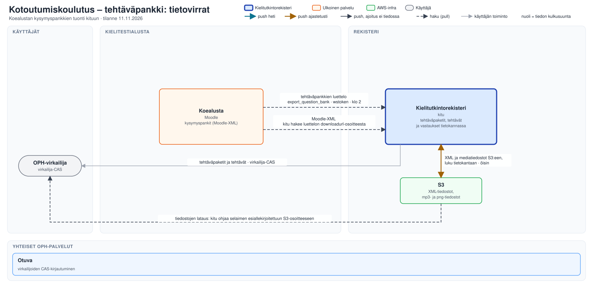

# Kotoutumiskoulutuksen tehtäväpankki

| Agenda                                      |
| ------------------------------------------- |
| 1. Mikä tehtäväpankki on ja kuka tekee mitä |
| 2. Sanasto                                  |
| 3. Tehtäväpankin elinkaari                  |
| 4. Tekninen yleiskuva                       |
| 5. Ansat ja päätökset                       |
| 6. Ylläpito                                 |
| 7. Kokeile itse (demo)                      |
| Kysymykset                                  |
| 8. Lisälukemista (ei käydä läpi)            |

## 1. Mikä tehtäväpankki on ja kuka tekee mitä

Kotoutumiskoulutuksen päättötestin tehtävät ovat Koealustalla kurssikohtaisissa
**tehtäväpankeissa** (Moodlen kysymyspankki). Kielitutkintorekisteri hakee jokaisen kurssin
tehtäväpankin Koealustalta kerran yössä, säilyttää sen jokaisen erilaisen version ja näyttää
sisällön OPH:n virkailijalle: tehtäväryhmät, tehtävät, vastausvaihtoehdot sekä kuvat ja
äänitiedostot.

Tehtäväpankki on oma kokonaisuutensa, vaikka se tulee samasta järjestelmästä kuin
päättötestin suoritukset: sillä on oma eräajonsa, omat taulunsa ja oma tallennuspaikkansa S3:ssa.

### Kuka tekee mitä

| Osapuoli               | Rooli                                                                                                            |
| ---------------------- | ---------------------------------------------------------------------------------------------------------------- |
| Koealusta              | Moodle, jossa tehtäväpankit ovat. Tuottaa kustakin kurssista ladattavan XML-tiedoston ja luettelon tiedostoista. |
| Kielitutkintorekisteri | Hakee luettelon ja muuttuneet XML:t, tallentaa ne S3:een, purkaa sisällön tietokantaan ja näyttää sen.           |
| AWS S3                 | Säilyttää XML-tiedostot ja niistä puretut kuva- ja äänitiedostot.                                                |
| OPH-virkailija         | Selaa tehtäväpankkeja ja niiden versioita ja lataa XML:n tai yksittäisen tiedoston.                              |

[](https://raw.githubusercontent.com/Opetushallitus/kielitutkintorekisteri/refs/heads/main/docs/technical/kaaviot/kotoutumiskoulutus-tehtavapankki.svg)

Kolme asiaa, jotka kannattaa panna merkille:

- **Tieto kulkee yhteen suuntaan.** Kielitutkintorekisteri hakee Koealustalta eikä lähetä sinne
  mitään. Tehtäviä ei muokata Kielitutkintorekisterissä.
- **Mitään ei poisteta.** Jokainen erilainen versio jää talteen, ja vanhemmat versiot näkyvät
  listalla uusimman alla.
- **Tiedostot ovat isoja.** Kuvat ja äänet ovat XML:n sisällä base64-koodattuina, joten yksi
  tehtäväpankki voi olla gigatavuja. Siksi tuonti välttää kaiken turhan latauksen ja käsittelyn.

## 2. Sanasto

| Termi                       | Merkitys                                                                                                                        | Koodissa                                                                      |
| --------------------------- | ------------------------------------------------------------------------------------------------------------------------------- | ----------------------------------------------------------------------------- |
| Tehtäväpankki               | Yhden Koealustan kurssin tehtävät yhtenä Moodle-XML-tiedostona. Käyttöliittymän valikossa "Testipaketit".                       | `QuestionBankMetadata`, Koealustan "question bank"                            |
| Tehtäväpaketti              | Tehtäväpankin yksi tallennettu versio Kielitutkintorekisterin tietokannassa.                                                    | `TehtavapakettiEntity`, taulu `tehtavapaketti`                                |
| Tehtäväryhmä                | Paketin osa, Moodlen kysymyskategoria. Tehtävät näytetään ryhmittäin XML:n järjestyksessä.                                      | `TehtavaryhmaEntity`, taulu `tehtavaryhma`                                    |
| Tehtävä                     | Yksi kysymys: tyyppi, nimi, tehtäväteksti ja asetukset.                                                                         | `TehtavaEntity`, taulu `tehtava`                                              |
| Tehtävätyyppi               | Moodlen kysymystyyppi. Kielitutkintorekisteri tallentaa kuvauksen, monivalinnan, lyhyen vastauksen, esseen ja ääninauhoituksen. | `tyyppi`: `description`, `multichoice`, `shortanswer`, `essay`, `cloudpoodll` |
| Liite                       | Tehtävään upotettu kuva- tai äänitiedosto. Puretaan XML:stä omaksi tiedostoksi S3:een.                                          | `TehtavaTiedostoEntity`, taulu `tehtava_tiedosto`                             |
| Lähdetiedot                 | Koealustan kertomat tiedot tiedostosta: luontihetki, versio, kieli ja kurssin alku.                                             | `lahde_filegenerated`, `lahde_version`, `lahde_language`, `lahde_published`   |
| Luontihetki (filegenerated) | Hetki, jolloin Koealusta tuotti XML-tiedoston. Sen perusteella päätetään, ladataanko tiedosto.                                  | `QuestionBankMetadata.generated`                                              |
| Sisällön tunniste           | XML-tiedoston SHA-256-tiiviste. Sama tunniste tarkoittaa samaa sisältöä.                                                        | `versio_hash`                                                                 |
| Kurssikansio                | S3-hakemisto, jossa on yhden kurssin kaikki XML-tiedostot ja liitteet. Nimi on kurssin tunniste ja nimi.                        | esim. `42-Suomi_alkeet/`                                                      |

## 3. Tehtäväpankin elinkaari

### Yöajo

Eräajo tekee joka yö kolme vaihetta:

1. **Lataus.** Hakee Koealustalta luettelon kursseista ja niiden tehtäväpankeista ja lataa
   jokaisen, jonka luontihetki on eri kuin tallennetulla uusimmalla versiolla. Ladattu XML
   tallennetaan S3:een uuteen tiedostoon kurssin kansioon.
2. **Käsittely.** Ottaa jokaisen kurssikansion uusimman XML:n. Jos samansisältöinen versio on jo
   tietokannassa, päivitetään vain sen lähdetiedot. Muuten XML puretaan: liitteet omiksi
   S3-tiedostoikseen ja tehtävät tietokantaan uudeksi tehtäväpaketiksi.
3. **Siivous.** Poistaa kunkin kurssikansion samansisältöiset XML-tiedostot niin, että vanhin jää.

Mitä kullekin tehtäväpankille tapahtuu:

| Tilanne                                                       | Mitä tapahtuu                                                                                                     |
| ------------------------------------------------------------- | ----------------------------------------------------------------------------------------------------------------- |
| Uusi kurssi                                                   | XML ladataan ja puretaan. Listalle tulee uusi kurssi.                                                             |
| Luontihetki ennallaan                                         | Ei ladata mitään.                                                                                                 |
| Koealusta on tuottanut tiedoston uudelleen, sisältö ennallaan | XML ladataan, uusi luontihetki tallennetaan olemassa olevalle versiolle ja ladattu kopio poistetaan siivouksessa. |
| Sisältö on muuttunut                                          | XML ladataan ja puretaan uudeksi versioksi. Vanha versio jää listalle uuden alle.                                 |
| Kurssin nimi on muuttunut                                     | Uusi nimi tarkoittaa uutta kurssikansiota, joten listalle tulee uusi rivi samalla kurssitunnisteella.             |

Tehtävät ryhmitellään XML:n kategorioiden mukaan. Kategoriaa edeltävät tehtävät kootaan ryhmään
"(jaottelematta)". Tehtävätyyppejä, joita Kielitutkintorekisteri ei tunne, ei tallenneta.

### Miten sama sisältö tunnistetaan

Yöajon jokainen vaihe tekee oman vertailunsa, ja jokainen vertailu vastaa eri kysymykseen:

| Vaihe     | Kysymys                              | Mitä verrataan                                                                                             | Jos sama                                                           |
| --------- | ------------------------------------ | ---------------------------------------------------------------------------------------------------------- | ------------------------------------------------------------------ |
| Lataus    | Kannattaako tiedosto ladata?         | Koealustan luettelon luontihetkeä kurssin uusimman tallennetun version luontihetkeen                       | Tiedostoa ei ladata.                                               |
| Käsittely | Onko tämä uusi versio?               | XML-tiedoston sisällön tunnistetta saman kurssitunnisteen kaikkien tallennettujen versioiden tunnisteisiin | Uutta versiota ei tehdä, vaan osunut versio saa uudet lähdetiedot. |
| Siivous   | Onko S3:ssa saman sisällön kopioita? | Kurssikansion XML-tiedostojen kokoa ja S3:n laskemaa tiivistettä (ETag)                                    | Vanhin tiedosto jää, muut poistetaan.                              |

Kolme asiaa, jotka tästä seuraavat:

- **Lataus ei katso sisältöä.** Luontihetki kertoo vain, että Koealusta on tuottanut tiedoston
  uudelleen. Siksi saman sisällön uudelleentuotanto ladataan kerran, ja vasta käsittely toteaa
  sen samaksi.
- **"Sama" tarkoittaa tavu tavulta samaa.** Sisällön tunniste on koko tiedoston SHA-256-tiiviste,
  joka lasketaan ennen kuin XML:ää luetaan. Tehtäviä ei vertailla tehtävä kerrallaan, joten mikä
  tahansa muutos tiedostossa, myös pelkkä välilyönti, tekee siitä uuden version.
- **Tunniste on kurssikohtainen, ei kansiokohtainen.** Käsittely vertaa saman kurssitunnisteen
  kaikkiin versioihin, myös muissa kansioissa oleviin. Kun kurssin nimi muuttuu mutta sisältö ei,
  uusi kansio tulee listalle, mutta tietokantaan ei synny uutta versiota. Uuden kansion rivillä
  on siksi "Lataa XML" eikä "Näytä sisältö", ja sisällön näkee vanhan kansion riviltä.

### Kun jokin epäonnistuu

| Tilanne                                                      | Mitä tapahtuu                                                                                            |
| ------------------------------------------------------------ | -------------------------------------------------------------------------------------------------------- |
| Koealusta vastaa yhden kurssin lataukseen virheilmoituksella | Kurssi jää lataamatta, muut käsitellään. Ajo merkitään lopuksi epäonnistuneeksi ja virhe kertoo kurssin. |
| Yhden kurssin XML on rikki                                   | Kurssi jää käsittelemättä, muut käsitellään. Ajo merkitään lopuksi epäonnistuneeksi.                     |
| Luettelon haku epäonnistuu tai lataus vastaa virhetilalla    | Koko ajo keskeytyy heti, eikä mitään tallenneta.                                                         |

Epäonnistunut kurssi yritetään uudelleen seuraavana yönä. Virheitä ei tallenneta erikseen
kuten päättötestin suorituksissa, vaan ne näkyvät eräajon historiassa.

## 4. Tekninen yleiskuva

Koodi on kahdessa paketissa:

- `kotoutumiskoulutus/koealusta/tehtavapankki/` — Koealustan asiakas, tuonti, XML:n jäsennys ja
  sivut
- `tehtavapankki/` — tietokannan entiteetit ja kyselyt. Taulut on nimetty yleisesti, koska
  lähdejärjestelmä on paketin oma tieto (`lahdejarjestelma = moodle.koealusta`).

### Tallennus

S3-tiedostot ovat bucketissa `kitu-bucket-<ympäristö>`:

```
42-Suomi_alkeet/                                         kurssikansio: kurssin tunniste ja nimi
  2026-11-24T13:30:27.290999-fg1795519803-0.xml          XML: lataushetki, luontihetki (fg), järjestysnumero
  2026-11-24T13:30:27.290999-fg1795519803-0 assets/      XML:stä puretut liitteet
    image.png
    A2 Tietokonetuki äänitiedosto.mp3
```

Luontihetki on tiedostonimessä, ja muut lähdetiedot (versio, kieli, kurssin alku) ovat
S3-tiedoston omina metatietoina. Käsittely lukee ne sieltä.

| Taulu              | Sisältö                                                                       |
| ------------------ | ----------------------------------------------------------------------------- |
| `tehtavapaketti`   | Versio: kurssin tunniste, nimi, sisällön tunniste, S3-tiedosto ja lähdetiedot |
| `tehtavaryhma`     | Paketin ryhmät järjestyksessä                                                 |
| `tehtava`          | Ryhmän tehtävät: tyyppi, nimi, teksti ja asetukset (`metadata`, JSON)         |
| `tehtava_vastaus`  | Monivalinnan ja lyhyen vastauksen vaihtoehdot ja pisteet                      |
| `tehtava_tiedosto` | Tehtävän liitteet ja niiden S3-avaimet                                        |

Tauluja ei päivitetä eikä niistä poisteta: uusi sisältö on aina uusi tehtäväpaketti. Ainoa
päivitys on lähdetietojen kirjaus samansisältöiselle versiolle.

Bucket on versioitu, ja poistetun tai korvatun tiedoston aiempi versio säilyy 30 päivää
(`infra/lib/service-stack.ts`).

### Koealustan rajapinta

| Kutsu                                                                                         | Palauttaa                                                                     |
| --------------------------------------------------------------------------------------------- | ----------------------------------------------------------------------------- |
| `GET …/webservice/rest/server.php`, `wsfunction=local_completion_export_export_question_bank` | Kurssien luettelo: tunniste, nimi, luontihetki, versio, kieli ja latausosoite |
| Luettelon latausosoite, parametrina `token`                                                   | XML-tiedosto                                                                  |

Tunnistautuminen on sama Koealustan tunniste (`wstoken`, salaisuus `kielitesti-token`) kuin
päättötestin suorituksissa. Moodle voi vastata virheeseen tilalla 200 ja JSON-rungolla, joten
lataus tarkistaa, että vastaus alkaa XML:nä, ennen kuin se tallennetaan S3:een.

### Näkymät

| Reitti                             | Sivu                                                                                             |
| ---------------------------------- | ------------------------------------------------------------------------------------------------ |
| `/koto-tehtavapankki`              | Lista: kurssikansiot uusin ensin, kunkin versiot ja linkki sisältöön                             |
| `/koto-tehtavapankki/paketti/{id}` | Yhden version sisältö: lähdetiedot, ryhmät, tehtävät, vastaukset, metatiedot, kuvat ja äänet     |
| `/koto-tehtavapankki/lataa?key=…`  | Luo jokaisella pyynnöllä uuden 10 minuuttia voimassa olevan S3-osoitteen ja ohjaa selaimen sinne |

Lista luetaan S3:sta, sisältö tietokannasta. Jos versio on S3:ssa mutta ei tietokannassa,
listalla on "Lataa XML" -linkki "Näytä sisältö" -linkin sijaan. Sivuilla ei ole S3-osoitteita, vaan
kuvat, äänet ja latauslinkit osoittavat tähän reittiin, joten osoite luodaan vasta, kun selain
pyytää tiedostoa. Etusivun kotoutumiskoulutuksen
kortti näyttää kurssikansioiden määrän.

### Eräajo

| Eräajo                                                 | Aikataulu (tuotanto) | Asetus                                                                      |
| ------------------------------------------------------ | -------------------- | --------------------------------------------------------------------------- |
| Kotoutumiskoulutuksen kielitaidon tehtäväpankin lataus | öisin klo 2.00       | `kitu.kotoutumiskoulutus.koealusta.scheduling.importTehtavapankki.schedule` |

Eräajo on luokassa `TehtavapankkiScheduledTasks` ja kytketään päälle samalla asetuksella kuin
päättötestin haut (`…koealusta.scheduling.enabled`). Kokonaisuuden ohjaa
`TehtavapankkiImportService.importAndIngest`.

### Käyttöoikeudet

Sivut vaativat virkailijan `READ`-oikeuden. Koneille tarkoitettua rajapintaa ei ole.

## 5. Ansat ja päätökset

Jokaisesta kohdasta kerrotaan, mitä ei saa rikkoa ja miksi.

### Vanhempi tiedosto ei korvaa uudempia lähdetietoja

- **Sääntö:** samansisältöisen version lähdetietoja ei päivitetä tiedostosta, jonka luontihetki
  on vanhempi kuin tallennettu.
- **Miksi:** siivouksen jälkeen kurssikansion uusin jäljellä oleva XML on vanhin kopio, ja
  seuraava yöajo käsittelee sen. Ilman sääntöä vanhat arvot palautuisivat ja lataus alkaisi alusta.

### Siivous säilyttää vanhimman ja koskee vain XML-tiedostoja

- **Sääntö:** samansisältöisistä XML-tiedostoista jätetään vanhin. Liitteitä ei siivota.
- **Miksi:** tehtäväpaketti viittaa siihen XML-tiedostoon, josta se purettiin, ja sen liitteet
  ovat sen tiedoston nimisessä hakemistossa. Uudemman säilyttäminen katkaisisi viittaukset.

### Tiedostonimi on osa tietomallia

- **Sääntö:** älä muuta S3-tiedostojen nimeämistä (`{kurssi}-{nimi}/{aika}-fg{luontihetki}-{n}.xml`)
  äläkä S3-metatietojen avaimia.
- **Miksi:** käsittely lukee kurssin tunnisteen, nimen ja luontihetken tiedostonimestä ja muut
  lähdetiedot metatiedoista. Jo tallennetut tiedostot noudattavat nykyistä muotoa, ja esimerkiksi
  metatietoavaimen `lahde-published-ms` pääte on historiallinen, vaikka arvo on sekunteja.

### Muuttumatonta tehtäväpankkia ei jäsennetä

- **Sääntö:** sisällön tunniste lasketaan tiedostosta ennen jäsennystä, ja samansisältöinen
  versio ohitetaan ennen kuin XML luetaan. Älä siirrä jäsennystä tämän tarkistuksen edelle.
- **Miksi:** jäsennys lukee koko XML:n liitteineen muistiin. Gigatavujen tiedostoilla tämä
  aiheutti palvelussa muistipiikkejä silloin, kun jokainen tehtäväpankki jäsennettiin joka yö.

### Koealustan HTML siivotaan ennen näyttämistä

- **Sääntö:** tehtävien teksti näytetään `safeHtml`in kautta. Älä renderöi Koealustan HTML:ää
  sellaisenaan.
- **Miksi:** sisältö tulee toisesta järjestelmästä, ja sivuilla ei ole sisältöturvakäytäntöä
  (CSP), joten tekstiin upotettu skripti suorittuisi virkailijan istunnossa.

### Koealustan tunniste kulkee osoitteessa

- **Sääntö:** älä kirjaa Koealustan osoitteita lokiin tai jäljitystietoihin sellaisenaan.
- **Miksi:** tunniste on sekä luettelon (`wstoken`) että XML-latauksen (`token`) kyselyparametri.
  Jäljitystiedot viedään AWS:ään, ja `SalaisuudetPiilottavaSpanExporter` peittää arvot ennen vientiä.

## 6. Ylläpito

Yleinen ylläpito (lokit, hälytykset, deploy) on sivulla
[Ylläpito ja havainnointi](../technical/yllapito.md). Tässä on vain tehtäväpankkia koskeva osa.

### Mistä näkee, mitä tapahtuu

| Mitä haluat tietää                         | Mistä                                                                                                                                        |
| ------------------------------------------ | -------------------------------------------------------------------------------------------------------------------------------------------- |
| Onko yöajo mennyt läpi ja mikä epäonnistui | db-schedulerin käyttöliittymä `/db-scheduler`: ajon tila ja virheviesti, jossa on epäonnistuneet kurssit                                     |
| Mitä ajo latasi ja ohitti                  | Jäljitysspan `TehtavapankkiService.importTehtavapankki`: `tehtavapankki.metas.count`, `.skipped.count`, `.downloaded.count`, `.failed.count` |
| Mitä käsittely tallensi                    | Jäljitysspan `TehtavapankkiIngestService.ingestFromS3`: `ingest.dedup` sekä ryhmien, tehtävien ja tiedostojen määrät                         |
| Mitä S3:ssa on                             | Sivu `/koto-tehtavapankki` tai bucket AWS-konsolissa                                                                                         |
| Mitä Koealusta tarjoaa                     | Spanin `tehtavapankki.metas.count` kertoo luettelon pituuden                                                                                 |

### Tavalliset tukipyynnöt

- **"Tehtäväpankin uusi versio ei näy."** Tarkista eräajon viimeisin ajo. Jos ajo onnistui ja
  kurssi ohitettiin, Koealustan luettelossa on sama luontihetki kuin tallennetulla versiolla,
  eli Koealusta ei ole vielä tuottanut tiedostoa uudelleen. Jos versio on ladattu mutta sisältö
  on sama, listalle ei tule uutta riviä.
- **"Kurssi näkyy listalla kahdesti."** Kurssin nimi on muuttunut Koealustalla. Kummankin
  kansion versiot säilyvät.

### Ajo käsin

Ajon voi käynnistää db-schedulerin käyttöliittymästä. Se tekee saman kuin yöajo: muuttumattomat
tehtäväpankit ohitetaan, joten ajo on halpa toistaa.

## 7. Kokeile itse

Harjoitus ajetaan paikallisesti ilman AWS-tunnuksia ja ilman Koealustaa. Offline-profiilissa
Koealustan korvaa `MockTehtavapankkiClient`, joka tarjoaa yhden kurssin tehtäväpankin
paikallisesta tiedostosta, ja S3:n korvaa LocalStack. Luontihetki on tiedoston muokkausaika,
joten tiedoston koskeminen vastaa sitä, että Koealusta tuottaa sen uudelleen.

### Valmistelu

```shell
docker compose up -d

# Oma bucket, jottei harjoitus käsittele muita paikallisia tiedostoja
docker compose exec localstack awslocal s3 mb s3://perehdytys

# Muokattava kopio esimerkkitehtäväpankista
mkdir -p /tmp/tehtavapankki
cp server/src/main/resources/kotoutumiskoulutus/tehtavapankki/tehtavapankki-fixture.xml /tmp/tehtavapankki/Suomi_A2.xml
```

### Käynnistys

```shell
KITU_KOTOUTUMISKOULUTUS_TEHTAVAPANKKI_BUCKET=perehdytys \
MOCK_TEHTAVAPAKETTI_XML=/tmp/tehtavapankki/Suomi_A2.xml \
  ./scripts/start_offline_dev.sh ./scripts/start_local_server.sh
```

Avaa `http://localhost:8080/kielitutkinnot` ja valitse testikirjautumissivulta käyttäjä.
Valikon "Testipaketit" näyttää aluksi "Ei testipaketteja."

Ajojen tulokset näkyvät myös Jaegerissa osoitteessa `http://localhost:16686`: palvelu `kitu`,
operaatio `TehtavapankkiService.importTehtavapankki`, attribuutit
`tehtavapankki.downloaded.count` ja `tehtavapankki.skipped.count`.

### Ensimmäinen tuonti

Avaa valikosta "Eräajojen hallinta" ja käynnistä "Kotoutumiskoulutuksen kielitaidon
tehtäväpankin lataus" (Run now).

- Listalla on kurssi `2983-Suomi_A2` ja sillä yksi versio. Kurssin tunniste on laskettu
  tiedostopolusta ja nimi tiedostonimestä.
- "Näytä sisältö" avaa paketin: kaksi ryhmää ja yksitoista tehtävää. Ensimmäinen ryhmä,
  "(tyhjä nimi)", on Moodlen juurikategoria, jossa ei ole tehtäviä.
- Tehtävän kuva ja ääni latautuvat. Ne tulevat suoraan LocalStackista, jonne
  Kielitutkintorekisteri ohjaa selaimen.
- Bucketin sisältö: `docker compose exec localstack awslocal s3 ls --recursive s3://perehdytys`
  näyttää XML:n ja sen kaksi liitettä.

### Sama sisältö uudelleen

```shell
touch /tmp/tehtavapankki/Suomi_A2.xml
```

Käynnistä ajo. Luontihetki muuttui, joten XML ladataan (`downloaded.count` 1), mutta sisältö on
sama: listalla on yhä yksi versio, bucketissa yksi XML, ja paketin "Lähde generoitu" on uusi
aika. Käynnistä ajo vielä kerran muuttamatta mitään: nyt mitään ei ladata (`skipped.count` 1).

### Sisältö muuttuu

```shell
sed -i.bak 's/<text>Tervehdykset<\/text>/<text>Tervehdykset ja hyvästit<\/text>/' /tmp/tehtavapankki/Suomi_A2.xml
```

Käynnistä ajo. Listalla on nyt kaksi versiota, uusin ylimpänä ja vanhempi himmennettynä. Uuden
version ensimmäisen tehtävän nimi on "Tervehdykset ja hyvästit", vanhassa se on ennallaan.

### Kokeiltavaa itse

- Kirjoita tiedostoon kategoria, jonka nimi on tyhjä, tai poista kaikki kategoriat. Mihin
  ryhmään tehtävät päätyvät?
- Aseta katkaisukohta metodiin `TehtavapankkiIngestService.ingestFromS3` ja seuraa, milloin
  XML jäsennetään ja milloin ei.

Lopuksi voit poistaa bucketin: `docker compose exec localstack awslocal s3 rb --force s3://perehdytys`.

## 8. Lisälukemista

Dokumentaatio:

- [Integraatiot](../technical/integraatiot.md): Koealusta ja tehtäväpankin tietovirrat
- [Eräajot](../db-scheduler): eräajojen kuvaukset ja käyttöliittymä
- `CLAUDE.md`: tuonnin järjestys ja muut toteutuksen yksityiskohdat

Testit, joista näkee toiminnan esimerkkeinä
(`server/src/test/kotlin/fi/oph/kitu/kotoutumiskoulutus/koealusta/tehtavapankki/`):

| Aihe                                  | Testi                                                                          |
| ------------------------------------- | ------------------------------------------------------------------------------ |
| Lataus, ohitus, S3 ja siivous         | `TehtavapankkiServiceTest`                                                     |
| Käsittely, versiot ja lähdetiedot     | `TehtavapankkiIngestServiceTest`                                               |
| Koealustan luettelo ja XML-lataus     | `TehtavapankkiClientImplTest`                                                  |
| XML:n jäsennys tehtävätyypeittäin     | `TehtavapankkiXmlParserTest`                                                   |
| Sivut, latausohjaus ja HTML:n siivous | `TehtavapankkiViewControllerTest`                                              |
| Tietokantakyselyt                     | `server/src/test/kotlin/fi/oph/kitu/tehtavapankki/TehtavapankkiRepositoryTest` |
