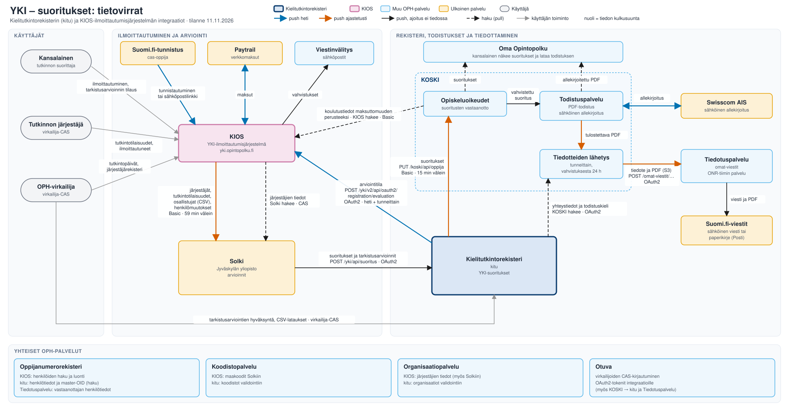
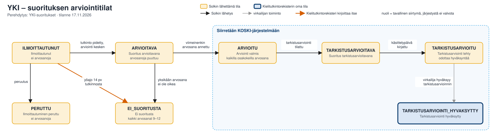

# YKI-suoritukset

| Agenda                            |
| --------------------------------- |
| 1. Mikä YKI on ja kuka tekee mitä |
| 2. Sanasto                        |
| 3. Suorituksen elinkaari          |
| 4. Tekninen yleiskuva             |
| 5. Ansat ja päätökset             |
| 6. Ylläpito                       |
| 7. Kokeile itse (demo)            |
| Kysymykset                        |
| 8. Lisälukemista (ei käydä läpi)  |

## 1. Mikä YKI on ja kuka tekee mitä

Yleinen kielitutkinto (YKI) on Opetushallituksen kielitutkinto, jolla aikuinen osoittaa
kielitaitonsa. Kielitutkintorekisteri on tutkintosuoritusten **rekisteri**: se ei järjestä tutkintoja, ota vastaan
ilmoittautumisia eikä arvioi, vaan säilyttää suoritukset, näyttää ne OPH:n virkailijoille ja
välittää ne eteenpäin.

### Tutkinnon rakenne

- **Kieli:** yhdeksän tutkintokieltä: englanti, espanja, italia, pohjoissaame, ranska, ruotsi,
  saksa, suomi ja venäjä (`Tutkintokieli`).
- **Taso:** tutkintoon ilmoittaudutaan yhdelle kolmesta tasosta. Taso määrää, mitkä arvosanat
  ovat mahdollisia (`Tutkintotaso`).

  | Taso      | Koodi | Arvosanat | Tason alittava tulos |
  | --------- | ----- | --------- | -------------------- |
  | Perustaso | `PT`  | 1–2       | alle 1               |
  | Keskitaso | `KT`  | 3–4       | alle 3               |
  | Ylin taso | `YT`  | 5–6       | alle 5               |

- **Osakokeet:** tutkinnossa on neljä osakoetta, ja jokainen arvioidaan erikseen: puhuminen
  (`PU`), kirjoittaminen (`KI`), tekstin ymmärtäminen (`TY`) ja puheen ymmärtäminen (`PY`).
  Suoritukseen kuuluvat vain ne osakokeet, joihin henkilö on ilmoittautunut. Vanhoissa
  suorituksissa on lisäksi rakenteet ja sanasto (`RS`) ja yleisarvosana (`YL`).

Yksi **suoritus** on siis yhden henkilön yksi tutkintokerta: tutkintopäivä, kieli, taso ja
osakokeiden arvosanat.

### Kuka tekee mitä

| Osapuoli               | Rooli                                                                                                                                                   |
| ---------------------- | ------------------------------------------------------------------------------------------------------------------------------------------------------- |
| Kansalainen            | Ilmoittautuu, osallistuu tutkintoon, näkee tuloksen ja lataa todistuksen Oma Opintopolusta. Voi tilata tarkistusarvioinnin.                             |
| Tutkinnon järjestäjä   | Oppilaitos tai muu organisaatio, joka pitää tutkintotilaisuuden. Näkyy suorituksella organisaation OID:na ja nimenä.                                    |
| KIOS                   | OPH:n ilmoittautumisjärjestelmä (`yki.opintopolku.fi`): ilmoittautumiset ja maksut. Vie osallistujat Solkiin ja näyttää kansalaiselle arvioinnin tilan. |
| Solki                  | Jyväskylän yliopiston järjestelmä, jossa suoritukset arvioidaan. **Kielitutkintorekisterin ainoa YKI-suoritusten lähde.**                               |
| Kielitutkintorekisteri | Rekisteri. Vastaanottaa suoritukset Solkista, lähettää ne KOSKI-järjestelmään ja arvioinnin tilan KIOSiin.                                              |
| OPH-virkailija         | Selaa ja hakee suorituksia Kielitutkintorekisterissä, lataa CSV-raportteja ja hyväksyy tarkistusarvioinnit.                                             |
| KOSKI                  | OPH:n opintosuoritusten tietovaranto. Tekee suorituksesta todistuksen ja tiedottaa siitä kansalaiselle.                                                 |
| Oppijanumerorekisteri  | Henkilöiden tunnisteet (oppijanumero). Kielitutkintorekisteri tarkistaa sieltä henkilön jokaisen vastaanoton yhteydessä.                                |

Tietovirtakaavio näyttää samat osapuolet ja niiden väliset yhteydet. Nuoli kertoo tiedon
kulkusuunnan ja nuolen väri sen, lähteekö tieto heti, ajastetusti vai käyttäjän toimesta.

[](https://raw.githubusercontent.com/Opetushallitus/kielitutkintorekisteri/refs/heads/main/docs/technical/kaaviot/yki-suoritukset.svg)

Kolme asiaa, jotka kaaviosta kannattaa panna merkille:

- **Tieto kulkee yhteen suuntaan.** Solki lähettää, Kielitutkintorekisteri vastaanottaa.
  Kielitutkintorekisteri ei kysy Solkilta mitään eikä lähetä suorituksia takaisin.
- **Kielitutkintorekisteri ei tee todistuksia eikä lähetä viestejä kansalaiselle.** Ne tekee
  KOSKI-järjestelmä, joka hakee Kielitutkintorekisteristä vain suorittajan yhteystiedot ja
  todistuskielen.
- **KIOS ei saa tuloksia.** Se saa Kielitutkintorekisteriltä pelkän arvioinnin tilan (esimerkiksi
  "arviointi valmis"), ei arvosanoja.

Rajapinnat ja ajoitukset on kuvattu tarkemmin sivulla [Integraatiot](../technical/integraatiot.md).

## 2. Sanasto

| Termi                          | Merkitys                                                                                                                                                                                                  | Koodissa                                                            |
| ------------------------------ | --------------------------------------------------------------------------------------------------------------------------------------------------------------------------------------------------------- | ------------------------------------------------------------------- |
| Suoritus                       | Yhden henkilön yksi tutkintokerta. Rekisterissä myös pelkkä ilmoittautuminen on suoritus, jolla ei vielä ole arvosanoja.                                                                                  | `YkiSuoritusEntity`, taulu `yki_suoritus`                           |
| Solki-tunniste                 | Solkin antama suorituksen numero. Pysyy samana koko suorituksen elinkaaren ajan ja yhdistää versiot toisiinsa.                                                                                            | `solkiId`, sarake `solki_id`                                        |
| Versio                         | Yksi rivi taulussa `yki_suoritus`. Jokainen Solkin lähetys, joka muuttaa jotain, lisää uuden rivin, eikä vanhoja muuteta. Suorituksen nykytila on sen viimeisin versio.                                   | `id`, `lastModified`                                                |
| Lähdejärjestelmä               | Mistä suoritus on tullut: `Solki` tai testidatan `OPHTesti`.                                                                                                                                              | `LahdejarjestelmanTunniste`, `Lahdejarjestelma`                     |
| Osakoe                         | Tutkinnon osa, jolla on oma arvosana ja arviointipäivä.                                                                                                                                                   | `TutkinnonOsa`, taulu `yki_osakoe`                                  |
| Arvosana                       | Kokonaisluku. 1–6 ovat tasojen arvosanat ja 0 tarkoittaa tason alittavaa tulosta. 9–12 eivät ole arvosanoja vaan merkintöjä (ks. alla). Puuttuva arvosana tarkoittaa, ettei osakoetta ole vielä arvioitu. | `Koodisto.YkiArvosana`                                              |
| Arviointitila                  | Suorituksen tila elinkaarella, kahdeksan arvoa (ks. osio 3).                                                                                                                                              | `Arviointitila`                                                     |
| Arviointipäivä                 | Päivä, jona arviointi valmistui. Puuttuu, kunnes suoritus on arvioitu.                                                                                                                                    | `arviointipaiva`                                                    |
| Tarkistusarviointi             | Kansalaisen pyytämä uusi arviointi valituille osakokeille. Sillä on asiatunnus, saapumispäivä, käsittelypäivä, tieto muuttuneista arvosanoista ja perustelu.                                              | `YkiTarkastusarviointi`, taulu `yki_tarkistusarviointi`             |
| Tarkistusarvioinnin hyväksyntä | Virkailijan Kielitutkintorekisterissä tekemä merkintä, jolla tarkistusarvioinnin tulos vahvistetaan. Ainoa tila, jonka Kielitutkintorekisteri asettaa itse virkailijan toimesta.                          | `YkiService.hyvaksyTarkistusarvioinnit`                             |
| Asiatunnus                     | Tarkistusarvioinnin tunniste OPH:n asianhallinnassa.                                                                                                                                                      | `tarkistusarvioinninAsiatunnus`                                     |
| Todistuskieli                  | Kieli, jolla KOSKI-järjestelmä tekee todistuksen: suomi, ruotsi tai englanti.                                                                                                                             | `Todistuskieli`                                                     |
| Oppijanumero                   | Henkilön pysyvä tunniste Oppijanumerorekisterissä (OID). Kielitutkintorekisteri vaihtaa vastaanotossa linkitetyn oppijanumeron henkilön pääasialliseen (master) oppijanumeroon.                           | `suorittajanOID`, `OppijanumeroValidation.mapHenkiloOidToMasterOid` |
| Opiskeluoikeus                 | KOSKI-järjestelmän tietue, johon suoritus on tallennettu. Kielitutkintorekisteri saa sen OID:n vastauksena siirrosta.                                                                                     | `koskiOpiskeluoikeus`                                               |

Arvosanan erikoisarvot:

| Arvo | Merkitys        | Vaikutus                                                                                             |
| ---- | --------------- | ---------------------------------------------------------------------------------------------------- |
| 9    | Ei voi arvioida |                                                                                                      |
| 10   | Keskeytetty     | Osakoetta ei viedä KOSKI-järjestelmään.                                                              |
| 11   | Vilppi          | Suoritusta ei siirretä KOSKI-järjestelmään eikä tilaa KIOSiin.                                       |
| 12   | Ei suoritusta   | Henkilö ilmoittautui osakokeeseen mutta ei suorittanut sitä. Osakoetta ei viedä KOSKI-järjestelmään. |

Koodissa "oikea arvosana" tarkoittaa arvoa alle 9.

## 3. Suorituksen elinkaari

Suorituksen tila on sen viimeisimmän version `arviointitila`. Solki kertoo tilan jokaisessa
lähetyksessä, ja Kielitutkintorekisteri tarkistaa vain, että tila ja lähetyksen sisältö sopivat yhteen.

[](https://raw.githubusercontent.com/Opetushallitus/kielitutkintorekisteri/refs/heads/main/docs/technical/kaaviot/yki-arviointitilat.svg)

| Tila                            | Mitä lähetykseltä vaaditaan                                           | KOSKI-siirto | Tila KIOSiin |
| ------------------------------- | --------------------------------------------------------------------- | ------------ | ------------ |
| `ILMOITTAUTUNUT`                | Ei arvosanoja, ei arviointipäivää                                     | ei           | kyllä        |
| `PERUTTU`                       | Ei arvosanoja, ei arviointipäivää                                     | ei           | kyllä        |
| `EI_SUORITUSTA`                 | Jokaisella osakokeella arvo 9–12                                      | ei           | kyllä        |
| `ARVIOITAVA`                    | Vähintään yhdeltä osakokeelta puuttuu arvosana                        | ei           | kyllä        |
| `ARVIOITU`                      | Arviointipäivä, jokaisella osakokeella arvosana, vähintään yksi oikea | kyllä        | kyllä        |
| `TARKISTUSARVIOITAVA`           | Tarkistusarviointi ilman käsittelypäivää                              | kyllä        | kyllä        |
| `TARKISTUSARVIOITU`             | Tarkistusarviointi, jolla on käsittelypäivä                           | kyllä        | kyllä        |
| `TARKISTUSARVIOINTI_HYVAKSYTTY` | Solki ei voi lähettää tätä tilaa                                      | kyllä        | kyllä        |

Säännöt ovat `YkiSuoritusValidation`issa, ja virheellinen lähetys hylätään kokonaan (HTTP 400).

### Mitä Kielitutkintorekisteri tekee tilan perusteella

- **Uusi versio.** Jokainen lähetys lähdejärjestelmästä (Solki) Kielitutkintorekisteriin, joka eroaa suorituksen viimeisimmästä versiosta, tallentuu
  uutena versiona. Samojen tietojen lähetys uudelleen ei tee mitään.
- **Arvioinnin tila KIOSiin.** Kielitutkintorekisteri lähettää tilan ilmoittautumisjärjestelmään heti jokaisen
  vastaanotetun lähetyksen ja jokaisen hyväksynnän jälkeen. Epäonnistuneet lähetykset yritetään
  uudelleen tunnin välein, paitsi jos tila on `ILMOITTAUTUNUT` tai `PERUTTU`.
- **KOSKI-siirto.** Eräajo lähettää 15 minuutin välein jokaisen version, jota ei ole vielä
  käsitelty. KOSKI-järjestelmään menevät vain arvioidut suoritukset (kaavion katkoviivalla rajattu
  alue, `Arviointitila.arvioitu()`). Tarkistusarvioinnin jokainen vaihe on uusi versio, joten
  suoritus lähetetään niiden aikana useita kertoja ja KOSKI-järjestelmä päivittää samaa
  opiskeluoikeutta. Jos KOSKI-järjestelmään siirretty tieto ei tosiasiallisesti muutu, KOSKI ei
  tallenna siitä uutta versiota, mutta Kielitutkintorekisterin ei tarvitse huolehtia siitä.
- **Tarkistusarvioinnin hyväksyntä.** `TARKISTUSARVIOITU` on tila, jossa suoritus odottaa tutkintotoimikunnan hyväksyntää.
  Virkailija hyväksyy tarkistusarvioinnin Kielitutkintorekisterin sivulla ja antaa hyväksymispäiväksi tutkintotoimikunnan
  kokouksen päivän. Kielitutkintorekisteri tallentaa siitä uuden version tilassa `TARKISTUSARVIOINTI_HYVAKSYTTY`.

### Poikkeukset

- **Vilppi (arvosana 11):** suoritus tallennetaan, mutta sitä ei siirretä KOSKI-järjestelmään
  eikä sen tilaa lähetetä KIOSiin.
- **Suoritus ilman oppijanumeroa:** näitä on vain vanhassa, tietokantamigraatioilla tuodussa
  historiadatassa. Rajapinta ei hyväksy sellaista, eikä niitä lähetetä mihinkään.
- **Tutkinnosta pois jäänyt:** jos suoritus on yhä tilassa `ILMOITTAUTUNUT` 14 päivää
  tutkintopäivän jälkeen, Kielitutkintorekisterin yöajo kirjoittaa sille version tilassa `EI_SUORITUSTA`.
- **Hyväksytyn tarkistusarvioinnin uusi lähetys:** jos Solki lähettää hyväksytyn suorituksen
  uudelleen tilassa `TARKISTUSARVIOITU`, Kielitutkintorekisteri säilyttää tilan `TARKISTUSARVIOINTI_HYVAKSYTTY`,
  vaikka arvosanat olisivat muuttuneet.
- **Siirtymiä ei valvota.** Kielitutkintorekisteri ei tarkista, mistä tilasta suoritus tulee, joten Solki voi
  esimerkiksi lähettää suorituksen suoraan tilassa `ARVIOITU` tai palauttaa arvioidun takaisin
  tilaan `ARVIOITAVA`. Kaavion nuolet kuvaavat tavallisen kulun.

## 4. Tekninen yleiskuva

YKI-suoritusten koodi on paketissa `yki/` (controller ja service) ja `yki/suoritukset/` (tietokanta-entity ja kyselyt, sivut).

Vastaanotettavan JSONin rakenne ja validointi paketissa `tiedontuontischema/`.

Ulospäin suuntautuvat integraatiot ovat omissa paketeissaan `koski/` ja `ilmoittautumisjarjestelma/`.

### Taulut ja versiointi

| Taulu                           | Sisältö                                                                             | Versioitu |
| ------------------------------- | ----------------------------------------------------------------------------------- | --------- |
| `yki_suoritus`                  | Suorituksen versio: henkilö, tutkinto, arviointitila, KOSKI-siirron tila            | kyllä     |
| `yki_osakoe`                    | Suoritusversion osakokeet: tyyppi, arvosana, arviointipäivä                         | kyllä     |
| `yki_tarkistusarviointi`        | Tarkistusarviointi: asiatunnus, saapumis- ja käsittelypäivä, perustelu              | ei        |
| `yki_osakoe_tarkistusarviointi` | Mitä osakokeita tarkistusarviointi koski ja muuttuiko arvosana                      | kyllä     |
| `yki_suoritus_lisatieto`        | Kielitutkintorekisterin omat tiedot: hyväksymispäivä, KIOS-lähetyksen aika ja virhe | ei        |

`yki_suoritus` on **vain lisättävä** taulu: riviä ei päivitetä eikä poisteta, vaan muutos on aina
uusi rivi samalla `solki_id`:llä. Esimerkki yhden suorituksen riveistä:

| `id` | `solki_id` | `last_modified`  | `arviointitila`  |
| ---- | ---------- | ---------------- | ---------------- |
| 4101 | 183424     | 2.9.2026 10:12   | `ILMOITTAUTUNUT` |
| 4877 | 183424     | 14.10.2026 08:30 | `ARVIOITAVA`     |
| 5290 | 183424     | 3.11.2026 14:05  | `ARVIOITU`       |

Tästä seuraa kolme asiaa, jotka toistuvat kaikessa koodissa:

- **Kahdenlaisia tunnisteita.** `id` yksilöi version ja `solki_id` suorituksen. Tietosivun osoite
  `/yki/suoritukset/{id}` osoittaa versioon, mutta KOSKI-virheet, tarkistusarvioinnin hyväksyntä ja
  `yki_suoritus_lisatieto` käyttävät Solki-tunnistetta.
- **"Suoritus" tarkoittaa viimeisintä versiota.** Lähes jokainen kysely alkaa valitsemalla
  jokaiselle `solki_id`:lle uusimman rivin (`DISTINCT ON (solki_id) … ORDER BY last_modified DESC`).
  Kyselyt rakennetaan `YkiSuoritusSql`:n apufunktioilla, ei käsin.
- **Muuttumaton lähetys ei tee riviä.** `YkiSuoritusRepository.save` vertaa saapuvaa suoritusta
  viimeisimpään versioon ja jättää tallentamatta, jos ne ovat samat. Vertailu
  (`equalsIgnoringAnnotated(…, "DB")`) ohittaa kentät, jotka Kielitutkintorekisteri kirjoittaa itse
  ja joita Solki ei lähetä, kuten KOSKI-siirron ja KIOS-lähetyksen tilan.

Tarkistusarviointi ja lisätiedot eivät ole versioituja: niistä on yksi rivi, joka kirjoitetaan
yli. Suorituksen vanha versio näyttää siksi tarkistusarvioinnin uusimmat päivät.

Tietokantaa käytetään Spring JDBC:llä ilman JPA:ta. Migraatiot ovat hakemistossa
`server/src/main/resources/db/migration`.

### Rajapinnat ja näkymät

Koneille (`YkiApiController`, OAuth2):

| Reitti                                       | Kutsuja | Tarkoitus                                               |
| -------------------------------------------- | ------- | ------------------------------------------------------- |
| `POST /yki/api/suoritus`                     | Solki   | Suorituksen lähetys                                     |
| `GET /yhteystiedot/api/opiskeluoikeus/{oid}` | KOSKI   | Suorittajan yhteystiedot ja todistuskieli tiedotteeseen |

Virkailijalle (`YkiViewController`, CAS-kirjautuminen). Sivut renderöidään palvelimella
(`kotlinx.html`), eikä selaimessa ole sovelluskoodia.

| Reitti                                | Sivu                                                    |
| ------------------------------------- | ------------------------------------------------------- |
| `/yki/suoritukset`                    | Lista: haku, rajaus, järjestys, sivutus, versiohistoria |
| `/yki/suoritukset/{id}`               | Yhden version tietosivu                                 |
| `/yki/suoritukset/tilastot`           | Suoritusten määrät ryhmiteltynä                         |
| `/yki/tarkistusarvioinnit`            | Hyväksyntää odottavat tarkistusarvioinnit ja hyväksyntä |
| `/yki/tarkistusarvioinnit/hyvaksytyt` | Hyväksytyt tarkistusarvioinnit                          |
| `/yki/tarkistusarvioinnit/tilastot`   | Tarkistusarviointien tilastot                           |
| `/yki/koski-virheet`                  | Suoritukset, joiden KOSKI-siirto on epäonnistunut       |

Jokaisella listalla ja tilastolla on CSV-lataus, joka on `YkiApiController`in `GET`-reitti saman
nimisellä polulla (esimerkiksi `GET /yki/api/suoritukset`). Rajapintojen kuvaus esimerkkeineen on
osoitteessa `/kielitutkinnot/api-docs`.

### Eräajot

Ajastus tehdään db-schedulerilla, ja aikataulut ovat `application*.properties`-tiedostoissa.

| Eräajo                                               | Aikataulu (tuotanto) | Asetus                                                          |
| ---------------------------------------------------- | -------------------- | --------------------------------------------------------------- |
| Lähetä YKI-suoritukset KOSKI-palveluun               | 15 min välein        | `kitu.koski.scheduling.yki.schedule`                            |
| Lähetä YKI-arviointitilat KIOS-palveluun             | tunnin välein        | `kitu.yki.scheduling.retrySendingFailedArviointitilat.schedule` |
| Merkitse tutkinnosta poisjääneet YKI-ilmoittautuneet | öisin klo 3.45       | `kitu.yki.scheduling.merkitseEiSuoritetuiksi.schedule`          |

Eräajojen tila ja historia näkyvät db-schedulerin käyttöliittymässä, josta ajon voi myös
käynnistää käsin ([Eräajot](../db-scheduler)).

### Käyttöoikeudet

| Oikeus          | Kenellä                | Mihin                                                              |
| --------------- | ---------------------- | ------------------------------------------------------------------ |
| `YKI_TALLENNUS` | Solkin palvelukäyttäjä | `POST` ja `DELETE /yki/api/suoritus`                               |
| `READ`          | OPH-virkailija         | Kaikki sivut ja CSV-lataukset, myös tarkistusarvioinnin hyväksyntä |

Oikeudet tulevat Opintopolun käyttöoikeuspalvelusta (Otuva): koneille OAuth2-tokenissa,
virkailijalle CAS-kirjautumisessa. Säännöt ovat `security/WebSecurityConfig.kt`:n funktiossa
`configureCommonAuthorizations`, ja kaikki, mitä siellä ei mainita, vaatii virkailijan
`READ`-oikeuden.

## 5. Ansat ja päätökset

Jokaisesta kohdasta kerrotaan, mitä ei saa rikkoa ja miksi.

### Kenttä, jonka Kielitutkintorekisteri kirjoittaa itse

- **Sääntö:** jos lisäät `YkiSuoritusEntity`yn kentän, jota Solki ei lähetä vaan jonka
  Kielitutkintorekisteri täyttää itse, merkitse se `@IgnoreForEquality("DB")`. Kun koodi sitten
  itse tallentaa tällaisen kentän, sen on kutsuttava `save(…, forceWrite = true)`.
- **Miksi:** ilman annotaatiota kenttä eroaa Solkin lähetyksestä heti ensimmäisen kirjoituksen
  jälkeen, ja jokainen muuttumaton uudelleenlähetys luo turhan version. Näin kävi tuotannossa
  KOSKI-siirron ja KIOS-lähetyksen kentille. Annotaatiolla on kääntöpuoli: vertailu ei näe kentän
  muutosta, joten ilman `forceWrite`a Kielitutkintorekisterin oma tallennus jäisi tekemättä.

### Kaksi kyselynrakentajaa

- **Sääntö:** `YkiSuoritusSql.selectViimeisimmatSuoritukset(ehto)` on hauille, jotka palauttavat
  muutaman suorituksen (Solkin lähetyksen vertailu, KOSKI-siirron jono, tarkistusarvioinnit).
  `selectSuorituksetFull` ja `selectSuorituksetRoot` ovat koko rekisterin läpikäynneille (lista,
  laskenta, CSV). Älä vaihda niitä keskenään.
- **Miksi:** `selectSuorituksetFull` valitsee ensin jokaisen suorituksen viimeisimmän version ja
  suodattaa vasta sitten, joten yhdenkin suorituksen haku lukee koko taulun. Tämä hidasti jokaista
  Solkin lähetystä noin sekunnilla, kunnes haku siirrettiin toiseen rakentajaan. Toisin päin
  rivikohtaiset alikyselyt ovat massahaussa moninkertaisesti hitaampia. Mittaa muutos
  PostgreSQL 16:lla, koska paikallinen kanta on versio 18 ja rakentaa erilaisen
  kyselysuunnitelman kuin tuotanto.

### Henkilötunnusta ei säilytetä

- **Sääntö:** suoritukselle, jonka tutkintopäivä on 1.1.2026 tai myöhemmin, ei tallenneta
  henkilötunnusta mitään kautta.
- **Miksi:** Opetushallituksen linjaus: henkilötunnuksia ei enää tallenneta. Oppijanumero riittää
  yhdistämiseen oikeaan henkilöön. Rajapinta hylkää henkilötunnuksen sisältävän lähetyksen (400),
  ja `YkiSuoritusRepository.save` poistaa sen vielä varmuuden vuoksi. Jos virkailija tarvitsee
  henkilötunnukset CSV-tiedostoon, lataus hakee ne pyydettäessä Oppijanumerorekisteristä tallentamatta niitä.

### Suoritus ilman oppijanumeroa

- **Sääntö:** `suorittajanOID` on tietokannassa ja entiteetissä valinnainen, mutta rajapinnan
  `Henkilo.oid` on pakollinen. Älä tee siitä valinnaista.
- **Miksi:** oppijanumerottomia suorituksia on vain vuosien historiadatassa, joka tuotiin
  tietokantamigraatioilla. Oppijanumerottomia suorituksia ei lähetetä KOSKI-järjestelmään
  eikä KIOSiin, ja molemmat jonot suodattavat ne pois jo SQL:ssä.

### CSV-sarakkeet ovat sopimus

- **Sääntö:** älä nimeä uudelleen, poista tai siirrä `CSV_EXPORT`-saraketta. Uusi sarake lisätään
  `YkiSuoritusColumn`in loppuun.
- **Miksi:** virkailijoiden taulukkolaskentapohjat ja raportit nojaavat sarakkeiden nimiin ja
  järjestykseen.

### Tarkistusarvioinnin päivät eivät ole versioituja

- **Sääntö:** älä päättele suorituksen vanhasta versiosta, mitä tarkistusarvioinnista tiedettiin
  sillä hetkellä.
- **Miksi:** tarkistusarvioinnista ja hyväksymispäivästä on yksi rivi, joka kirjoitetaan yli.
  Hyväksymispäivä on lisäksi virkailijan antama tutkintotoimikunnan kokouksen päivä, ei päivä,
  jona hyväksyntä tehtiin. Sen kertoo hyväksytyn version `last_modified`.

### Rajapinnan esimerkit ovat testejä

- **Sääntö:** jokaisen OpenAPI-kuvauksen esimerkkipyynnön on kelvattava rajapinnalle sellaisenaan.
- **Miksi:** Solkin kehittäjät rakentavat integraationsa esimerkkien varaan. Build lähettää
  jokaisen esimerkin rajapinnalle ja kaatuu, jos vastaus ei ole 200.

### Ilmoitus saapuneista suorituksista nojaa yhteen attribuuttiin

- **Sääntö:** `YkiApiController.postHenkilosuoritus` asettaa jäljitysspanille attribuutin
  `arvioitu`. Älä aseta samannimistä attribuuttia muualla äläkä nimeä sitä uudelleen.
- **Miksi:** CloudWatchin mittari `PostYkiSuoritus` laskee arvioitujen suoritusten saapumiset tämän
  attribuutin perusteella (ks. osio 6). Jos mittari lakkaa täsmäämästä, mikään ei hälytä: ilmoitukset
  vain loppuvat. Määrittely ja sen perustelut ovat tiedostossa `infra/lib/log-groups-stack.ts`.

## 6. Ylläpito

Yleinen ylläpito (lokit, hälytykset, deploy) on sivulla
[Ylläpito ja havainnointi](../technical/yllapito.md). Tässä on vain YKI-suorituksia koskeva osa.

### Mistä näkee, mitä tapahtuu

| Mitä haluat tietää                         | Mistä                                                                                                                  |
| ------------------------------------------ | ---------------------------------------------------------------------------------------------------------------------- |
| Onko Solki lähettänyt suorituksia          | Slack-kanavan ilmoitus (ks. alla) tai listan sarake ja rajaus "Rekisteriintuontiaika"                                  |
| Mitä yhdelle suoritukselle on tapahtunut   | Tietosivu: versiot listalta valinnalla "Näytä versiohistoria", integraatiokaavio sivun lopussa                         |
| Miksi suoritus ei ole KOSKI-järjestelmässä | Tietosivun integraatiokaavion KOSKI-nuoli (siirron esto tai virhe ja sen aika) ja sivu `/yki/koski-virheet`            |
| Mitä KOSKI-järjestelmään lähetettäisiin    | `/yki/koski-request/{solki-tunniste}` palauttaa pyynnön JSONina                                                        |
| Onko arvioinnin tila mennyt KIOSiin        | Tietosivun integraatiokaavion KIOS-nuoli: lähetysaika tai virhe ja viimeisimmän yrityksen aika                         |
| Ovatko eräajot ajossa                      | db-schedulerin käyttöliittymä `/db-scheduler`: viimeisin ajo, seuraava ajo, historia ja käynnistys käsin               |
| Miksi Solkin lähetys hylättiin             | Vastauksen `errors`-lista kertoo kentän ja syyn. Sama näkyy sovelluksen lokissa (CloudWatch, lokiryhmä `KituService`). |

### Ilmoitus saapuneista suorituksista

Kun Solki lähettää arvioituja suorituksia, kanavalle tulee ilmoitus lähetyksen alkamisesta ja sen
päätyttyä yhteenveto tutkintopäivän, kielen, tason ja tilan mukaan. Tämä **ei ole virhehälytys**
vaan tieto virkailijoille siitä, että tulokset ovat saapuneet. Toteutus on CloudWatch-hälytys
`PostYkiSuoritus` ja Lambda `YkiSuoritusNotifications` (`infra/lib/log-groups-stack.ts`).

### KOSKI-siirron virheet

Sivu `/yki/koski-virheet` listaa suoritukset, joiden viimeisin siirto epäonnistui, ja
KOSKI-järjestelmän virheilmoituksen. Siirtoa yritetään uudelleen 15 minuutin välein, joten
ohimenevä vika korjaantuu itsestään ja rivi poistuu listalta. Pysyvä virhe johtuu yleensä
suorituksen tiedoista, ja se korjaantuu, kun Solki lähettää korjatun version. Virkailija voi
piilottaa virheen listalta, jos sille ei ole tehtävissä mitään.

Asetuksella `kitu.koski.yki.transferBlockedUntil` siirron voi pysäyttää tiettyyn hetkeen asti,
esimerkiksi kun tulokset halutaan julkaista vasta sovittuna päivänä. Testisuoritukset
(lähdejärjestelmä `OPHTesti`) siirtyvät silloinkin.

### Suorituksen lähettäminen käsin

`scripts/upload_yki_suoritus.sh` lähettää suorituksen rajapintaan samalla tavalla kuin Solki ja
hoitaa kirjautumisen. Sillä voi kokeilla rajapintaa testiympäristöissä (`--env dev`, `--env test`).
Oletuspyynnön lähdejärjestelmä on `Solki`. Vaihda se omassa pyynnössäsi arvoon `OPHTesti` ja käytä tunnistetta väliltä 900 000 000 ylöspäin, jottei testisuoritus osu Solkin suoritukseen.

## 7. Kokeile itse

Harjoitus ajetaan paikallisesti ilman AWS-tunnuksia ja ulkoisia palveluita. Siinä näkyy
versioinnin koko toiminta: uusi suoritus, muuttumaton uudelleenlähetys, muutos ja hylätty lähetys.

### Käynnistys

```shell
docker compose up -d db
./scripts/start_offline_dev.sh ./scripts/start_local_server.sh
```

Avaa `http://localhost:8080/kielitutkinnot`. Sovellus näyttää testikirjautumissivun, josta
valitaan käyttäjä; sen jälkeen YKI-suoritusten lista löytyy valikosta.

### Testidataa listalle

Rekisteri on aluksi tyhjä. Satunnaisia suorituksia saa avaamalla selaimessa osoitteen, jonka
viimeinen osa on luotavien suoritusten määrä:

```
http://localhost:8080/kielitutkinnot/dev/mockdata/yki/suoritus/50
```

Osoite palauttaa luodut suoritukset JSONina, ja ne näkyvät heti listalla. Data kirjoitetaan
suoraan tietokantaan ohi rajapinnan validoinnin, joten se sopii listan, haun ja rajausten
kokeiluun mutta ei kerro, mitä rajapinta hyväksyy. Reitti on käytössä vain paikallisessa
kehityksessä.

### Lähetä suoritus

```shell
B=http://localhost:8080/kielitutkinnot

# Solkin roolissa toimiva testitoken. Se on voimassa minuutin, joten hae uusi tarvittaessa.
TOKEN=$(curl -s -X POST $B/dev/oauth/token \
  -d grant_type=client_credentials -d client_id=SOLKI -d client_secret=x | jq -r .access_token)

# Esimerkkisuoritus tilassa ILMOITTAUTUNUT. Jokainen haku arpoo uuden tunnisteen,
# joten tallenna se tiedostoon.
curl -s $B/schema-examples/yki-suoritus-ilmoittautunut.json > suoritus.json

laheta() {
  curl -s -w ' [%{http_code}]\n' -X POST $B/yki/api/suoritus \
    -H "Authorization: Bearer $TOKEN" -H 'Content-Type: application/json' --data-binary @"$1"
}

laheta suoritus.json   # {"result":"OK"} [200]
```

Suoritus näkyy nyt listalla tilassa "Ilmoittautunut".

### Sama lähetys uudelleen

```shell
laheta suoritus.json   # {"result":"OK"} [200]
```

Vastaus on sama, mutta uutta versiota ei synny. Valitse listalta "Näytä versiohistoria"
(`…/yki/suoritukset?versionHistory=true`): rivejä on yhä yksi.

### Muutos

```shell
jq '.suoritus.arviointitila = "ARVIOITU"
    | .suoritus.arviointipaiva = "2026-11-16"
    | .suoritus.osat |= map(.arvosana = 5)' suoritus.json > arvioitu.json

laheta arvioitu.json   # {"result":"OK"} [200]
```

Versiohistoriassa on nyt kaksi riviä samalla Solki-tunnisteella. Avaa kumpikin tietosivu: vanhempi
varoittaa, ettei se ole viimeisin versio.

### Hylätty lähetys

```shell
jq '.suoritus.arviointitila = "ARVIOITU"' suoritus.json > virheellinen.json

laheta virheellinen.json   # {"statusCode":"400 BAD_REQUEST","errors":[…],"result":"Failed"} [400]
```

Tila `ARVIOITU` ilman arviointipäivää ja arvosanoja ei kelpaa. `errors` luettelee jokaisen virheen
kenttäpolkuineen, eikä mitään tallenneta.

### Kokeiltavaa itse

- Hae `yki-suoritus-tarkistusarvioitava.json`, vaihda tilaksi `TARKISTUSARVIOITU` ja lisää
  tarkistusarvioinnille `kasittelypaiva`. Hyväksy suoritus sivulla `/yki/tarkistusarvioinnit` ja
  katso, mitä versiohistoriaan ilmestyy.
- Aseta katkaisukohta metodiin `YkiSuoritusRepository.save` ja seuraa vertailua molemmissa
  tapauksissa.

Offline-ajossa KOSKI-siirto on pois päältä eikä ilmoittautumisjärjestelmään lähetetä mitään, joten
ne näkee vain testeistä (`KoskiServiceTest`, `IlmoittautumisjarjestelmaServiceTests`).

## 8. Lisälukemista

Dokumentaatio:

- [Integraatiot](../technical/integraatiot.md): KOSKI, KIOS, Solki ja Oppijanumerorekisteri
  rajapintoineen
- [Koodikonventiot](../technical/koodikonventiot.md): `Either`, validoinnin kolme vaihetta
- [Eräajot](../db-scheduler)
- [Ulkoiset rajapintakuvaukset](https://virkailija.testiopintopolku.fi/kielitutkinnot/api-docs):
  Solkille julkaistu kuvaus rajapinnasta `POST /yki/api/suoritus`
- `scripts/yki-historia-migration.md`: miten vuosien 2011–2026 historiadata tuotiin rekisteriin
- `CLAUDE.md`: tiivis muistio toteutuksen yksityiskohdista ja niiden syistä

Testit, joista näkee toiminnan esimerkkeinä (`server/src/test/kotlin/fi/oph/kitu/`):

| Aihe                         | Testi                                                                                    |
| ---------------------------- | ---------------------------------------------------------------------------------------- |
| Rajapinta ja validointi      | `yki/YkiApiControllerTest`, `yki/ArviointitilaTest`                                      |
| Tallennus ja versiointi      | `yki/suoritukset/YkiSuoritusRepositoryTest`                                              |
| Haku ja rajaukset            | `yki/suoritukset/YkiSuoritusFilterTest`, `yki/suoritukset/YkiSuoritusTekstihakuTest`     |
| KOSKI-siirto                 | `koski/KoskiServiceTest`, `koski/KoskiRequestMapperTest`                                 |
| Ilmoittautumisjärjestelmä    | `ilmoittautumisjarjestelma/IlmoittautumisjarjestelmaServiceTests`                        |
| Tarkistusarviointi           | `yki/YkiTarkistusarvioinnitViewTest`                                                     |
| Tutkinnosta poisjääneet      | `yki/YkiEiSuoritusMerkintaTest`                                                          |
| Käyttöliittymä päästä päähän | `e2e/tests/yki/yki-suoritukset.spec.ts`, `e2e/tests/yki/yki-tarkistusarvioinnit.spec.ts` |
