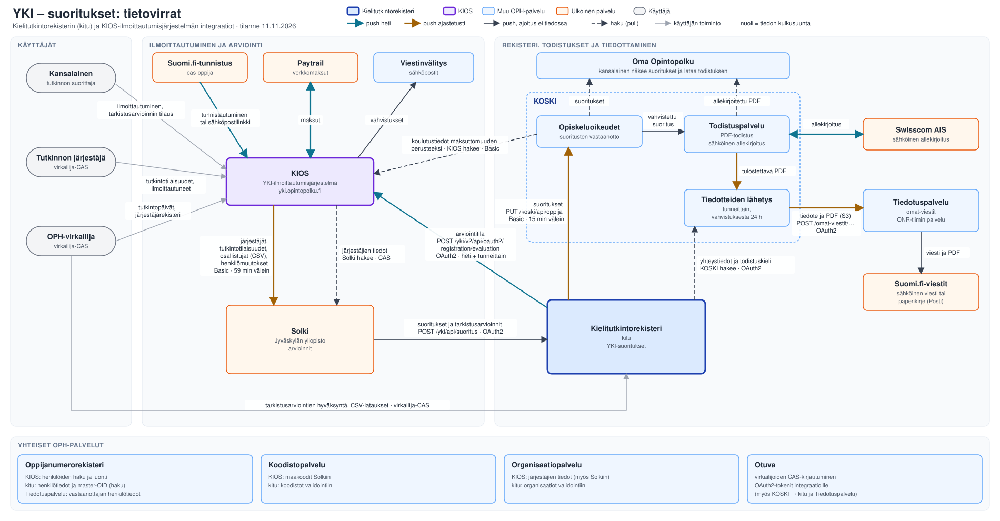
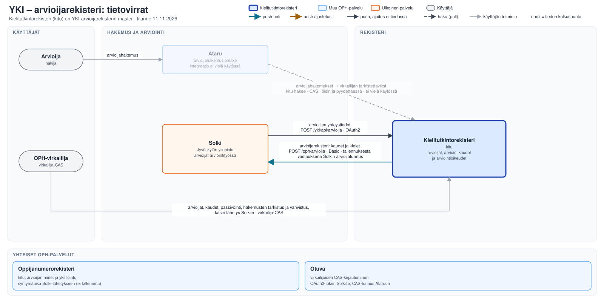
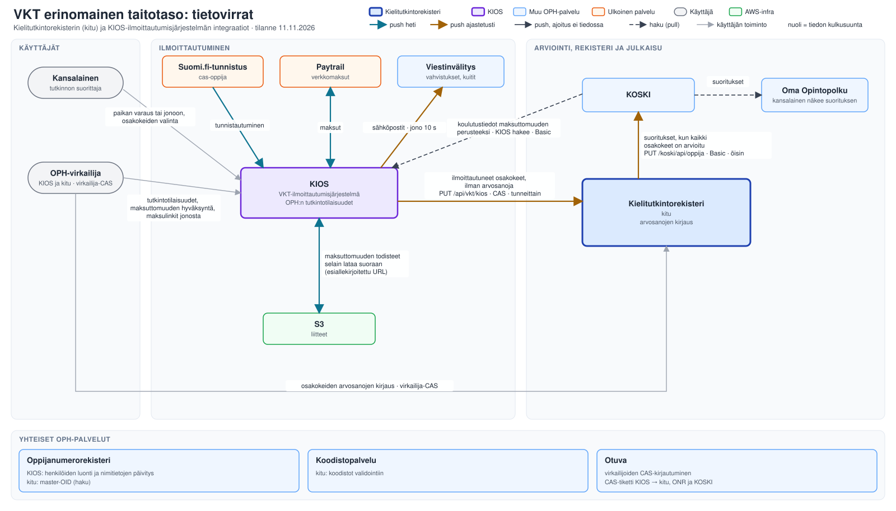
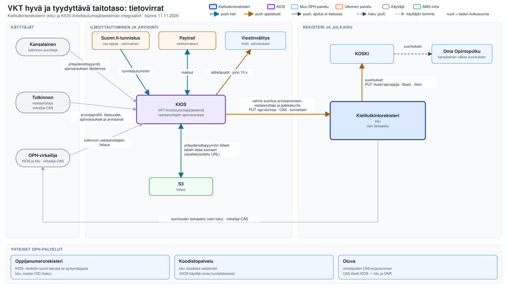
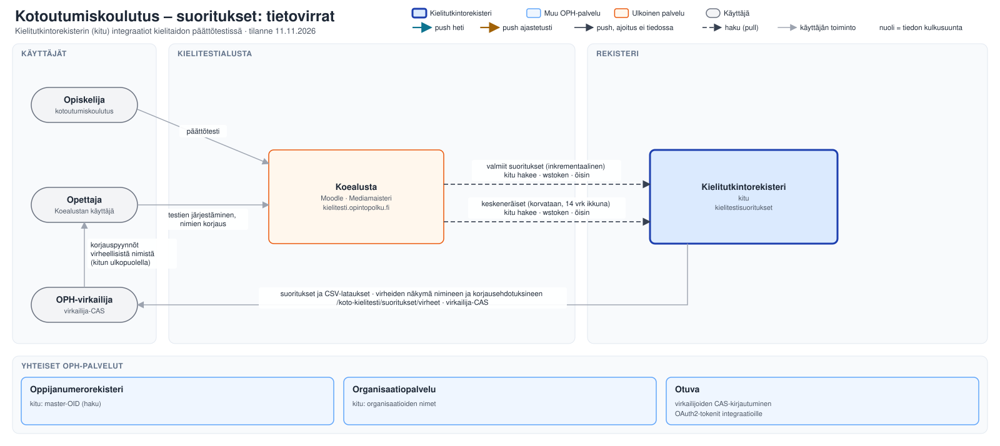
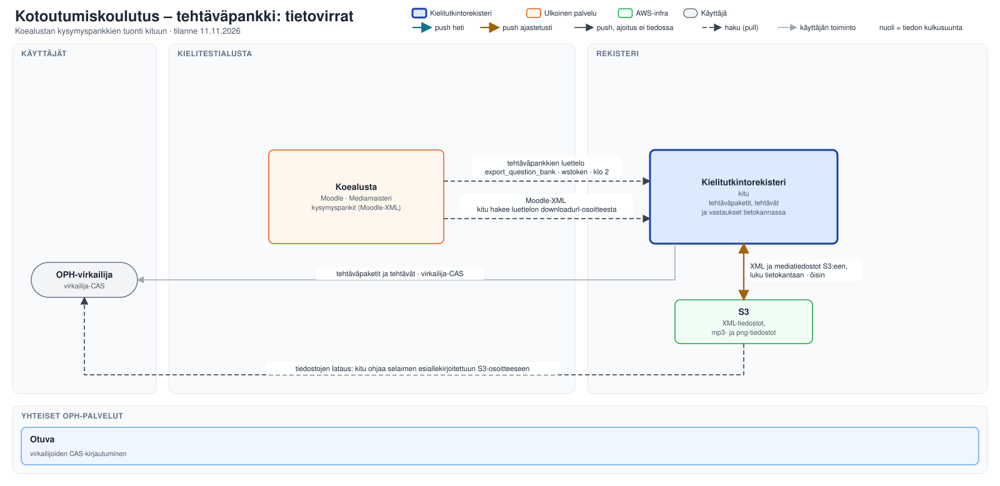

# Integraatiot

Kielitutkintorekisteri integroituu OPH:n ja kolmansien osapuolten järjestelmiin. Tämä sivu kuvaa
kullekin integraatiolle paketin, suunnan, asiakaskerroksen ja virhemallin.

## Kaaviot

Tietovirrat tutkinnoittain, mukaan lukien KIOS-ilmoittautumisjärjestelmän
([kieli-ja-kaantajatutkinnot](https://github.com/Opetushallitus/kieli-ja-kaantajatutkinnot) ja
vanha YKI-taustapalvelu [yki](https://github.com/Opetushallitus/yki)) omat integraatiot. Kaaviot
ovat muokattavia SVG-tiedostoja hakemistossa `kaaviot/`.

### YKI — suoritukset

[](https://raw.githubusercontent.com/Opetushallitus/kielitutkintorekisteri/refs/heads/main/docs/technical/kaaviot/yki-suoritukset.svg)

Solki ei lähetä tuloksia KIOSiin. KIOS saa kitulta vain suorituksen arviointitilan, jonka se
näyttää kansalaiselle tämän omalla sivulla.

### YKI — arvioijarekisteri

[](https://raw.githubusercontent.com/Opetushallitus/kielitutkintorekisteri/refs/heads/main/docs/technical/kaaviot/yki-arvioijat.svg)

### VKT — erinomainen taitotaso

[](https://raw.githubusercontent.com/Opetushallitus/kielitutkintorekisteri/refs/heads/main/docs/technical/kaaviot/vkt-erinomainen.svg)

### VKT — hyvä ja tyydyttävä taitotaso

[](https://raw.githubusercontent.com/Opetushallitus/kielitutkintorekisteri/refs/heads/main/docs/technical/kaaviot/vkt-hyva-ja-tyydyttava.svg)

**Avoin kysymys:** KIOS lähettää ajanvarauksen uudelleen vain, jos sen muokkausaika on myöhäisempi
kuin edellinen lähetys. Arvosanan korjaaminen ei päivitä ajanvarauksen muokkausaikaa, joten
ensimmäisen siirron jälkeen korjattu arvosana ei todennäköisesti koskaan päädy kituun
(`SyncRegisterEnrollments` repossa kieli-ja-kaantajatutkinnot).

### Kotoutumiskoulutus — suoritukset

[](https://raw.githubusercontent.com/Opetushallitus/kielitutkintorekisteri/refs/heads/main/docs/technical/kaaviot/kotoutumiskoulutus-suoritukset.svg)

Kotoutumiskoulutuksen tiedot eivät mene kitusta KOSKI-järjestelmään eivätkä KIOSiin, eivätkä KIOS
ja Solki liity kotoutumiskoulutukseen lainkaan.

### Kotoutumiskoulutus — tehtäväpankki

[](https://raw.githubusercontent.com/Opetushallitus/kielitutkintorekisteri/refs/heads/main/docs/technical/kaaviot/kotoutumiskoulutus-tehtavapankki.svg)

## KOSKI — suoritusten siirto

**Paketti:** `koski/` · **Suunta:** lähetys

Onnistuneet YKI- ja VKT-suoritukset lähetetään KOSKI-palveluun, joka julkaisee ne Oma
Opintopolussa.

- `KoskiService.sendYkiSuorituksetToKoski()` ja `sendVktSuorituksetToKoski()` palauttavat
  `Either<KoskiTechnicalException, KoskiTransferReport>`. Tekniset virheet palautetaan vasempana;
  tietosisällölliset virheet kerätään raporttiin ja merkitään uudelleen lähetettäviksi.
- `KoskiException`-hierarkiassa `KoskiTechnicalException` on uudelleenyritettävä.
- Eräajot `Lähetä YKI-suoritukset KOSKI-palveluun` ja VKT-vastine, ks. [Eräajot](../db-scheduler).

### YKI-todistukset ja tiedotteet KOSKI-järjestelmässä

KOSKI-järjestelmä tekee YKI-suorituksista todistukset ja tiedottaa niistä kansalaiselle. Tämä ei
kuulu kituun, mutta siihen kuuluu kitun yhteystietorajapinnan ainoa kutsuja (lähde: repo
[koski](https://github.com/Opetushallitus/koski), `src/main/scala/fi/oph/koski/todistus/`).

- **Todistuspalvelu** (osa KOSKI-sovellusta) luo vahvistetusta suorituksesta PDF-todistuksen ja
  allekirjoittaa sen sähköisesti Swisscom AIS -palvelulla. Kansalainen lataa allekirjoitetun
  todistuksen Oma Opintopolusta.
- **Tiedotteiden lähetys** (osa KOSKI-sovellusta, tunneittain, kun vahvistuksesta on kulunut 24 h)
  hakee kitusta suorittajan yhteystiedot ja todistuskielen (`GET /yhteystiedot/api/opiskeluoikeus/…`,
  OAuth2). Se tekee tulostettavan PDF:n ja lähettää tiedotteen **Tiedotuspalveluun**
  (ONR-tiimin erillinen palvelu, repo
  [tiedotuspalvelu](https://github.com/Opetushallitus/tiedotuspalvelu)). Tiedotuspalvelu lähettää
  sen Suomi.fi-viestien kautta joko sähköisenä viestinä tai Postin paperikirjeenä, jossa on kitun
  postiosoite.

## KIOS — ilmoittautumisjärjestelmä

**Paketit:** `ilmoittautumisjarjestelma/` (YKI), `vkt/` (VKT) · **Suunta:** lähetys (YKI-arviointitilat),
vastaanotto (VKT)

YKI-suoritusten arviointitilat ilmoitetaan KIOS:lle heti suoritustiedon päivittyessä
(`POST /yki/v2/api/oauth2/registration/evaluation`, OAuth2); eräajo
`Lähetä YKI-arviointitilat KIOS-palveluun` varmistaa perille menon katkosten jälkeen. KIOS näyttää
tilan kansalaiselle tämän omalla sivulla.

VKT-tiedot KIOS **lähettää** kitulle (`PUT /api/vkt/kios`) tunnin välein ajettavalla eräajolla
(`SyncRegisterEnrollments` KIOSissa). Erinomaisesta taitotasosta tulee ilmoittautuminen ilman
arvosanoja tutkintopäivän jälkeen, ja arvosanat kirjataan kitussa; hyvästä ja tyydyttävästä tulee
valmis suoritus, jonka arvosanat tutkinnon vastaanottaja on kirjannut KIOSiin. KIOS autentikoituu
**CAS-palvelutiketillä**, ei OAuth2-tokenilla — tästä syystä reitti
`/api/vkt/kios/j_spring_cas_security_check` on olemassa. Kitu ei lähetä VKT-tietoja takaisin KIOSiin.

- `IlmoittautumisjarjestelmaClientImpl.post(...)` → `Either<IlmoittautumisjarjestelmaException, T>`.
- Virhetyypit: `BadRequest`, `UnexpectedError`, `MalformedResponse`, `NullResponse`.

## Oppijanumerorekisteri

**Paketti:** `oppijanumero/` · **Suunta:** haku

Henkilötietojen ja oppijanumeroiden nouto.

- `OppijanumerorekisteriClient.getUser(...)` → `Either<OppijanumeroException, Oppija>`.
- Virhetyypit: `OppijaNotFoundException`, `BadRequest`, `UnexpectedError`, `MalformedResponse`,
  `NullResponse`. `HasResponse` merkitsee ne, joilla on raaka HTTP-vastaus liitteenä.

## Organisaatiopalvelu

**Paketti:** `organisaatiot/` · **Suunta:** haku

Oppilaitosten OID:t ja niiden hierarkia validoinnin tueksi.
`OrganisaatiopalveluClient.get(...)` → `Either<OrganisaatiopalveluException, T>`; virhetyypit
vastaavat oppijanumeropuolen mallia.

## Koodisto

**Paketti:** `koodisto/` · **Suunta:** haku

OPH:n keskitetty koodistopalvelu, mm. kielikoodien ja luokitusten validointiin.

## Koealusta (kotoutumiskoulutus)

**Paketti:** `kotoutumiskoulutus/koealusta/` · **Suunta:** haku + tiedoston tuonti

Moodle-pohjainen kielitestialusta, josta haetaan suoritustietoja ja Moodle-XML-tehtäväpaketteja.

- Valmiit suoritukset haetaan inkrementaalisesti (`from`-vesileima db-schedulerin tilassa;
  virheellisen ajon jälkeen vesileima jää sekuntia ennen varhaisinta epäonnistunutta
  suoritusta, jotta se haetaan uudelleen kunnes se korjaantuu), keskeneräiset korvataan joka ajolla kokonaan ja rajataan ilmoittautumisajan perusteella
  (`enrolledfrom`, ks. [Eräajot](../db-scheduler)).
- `KoealustaSuoritusValidator` validoi suoritusten datan →
  `Either<KoealustaMappingError.*Failure, …>`.
- `tehtavapankki/TehtavapankkiIngestService` lataa XML:t S3:sta, parsii ne ja tallentaa yleiseen
  tehtäväpankki-skeemaan.

## Solki — YKI-tietojen lähde ja arvioijarekisterin vastaanottaja

**Paketit:** `yki/`, `yki/arvioijat/solki/` · **Suunta:** kaksisuuntainen

Yleiset kielitutkinnot tulevat Jyväskylän yliopiston Solki-järjestelmästä. Arvioijarekisterin
master on kitu.

### Arvioijarekisterin lähetys (kitu → Solki)

Jokainen kitussa tehty tallennus lähetetään Solkille:

```
POST {kitu.yki.baseUrl}arvioija
Authorization:   Basic (kitu.yki.username/password)
Idempotency-Key: {arvioijaOid}:{versio}
```

Runko on `SolkiArvioijaRequest`; henkilötunnusta ei lähetetä. **`tila`-kenttää ei lähetetä**: tila
lasketaan kauden päivistä (`Rekisterointitila`), joten lähetetty arvo vanhenisi vastaanottajan
kopiossa kauden umpeutuessa. Vastaanottaja johtaa tilan `kaudenAlkupaiva`n ja
`kaudenPaattymispaiva`n välistä, **päättymispäivä mukaan lukien**.

`syntymapaiva` haetaan ONR:stä lähetyshetkellä (`OppijanumeroService.getHenkiloByMasterOid`); kitu
ei säilytä sitä. Kolme tapausta:

| ONR                                                | Kitu tekee                                                                   |
| -------------------------------------------------- | ---------------------------------------------------------------------------- |
| vastaa, syntymäaika on                             | lähettää kentän muodossa `yyyy-MM-dd`                                        |
| vastaa, syntymäaikaa ei ole (yksilöimätön henkilö) | jättää kentän pois (`@JsonInclude(NON_NULL)`) ja merkitsee rivin lähetetyksi |
| ei vastaa                                          | **ei lähetä lainkaan**: `merkitseLahetysvirhe`, ja rivi jää jonoon           |

Viimeinen tapaus epäonnistuu tarkoituksella kiinni: vajaana lähtenyt rivi merkittäisiin
lähetetyksi, jolloin ONR-katko jättäisi pysyvän aukon Solkin kopioon.

**Lähetysjono** elää `yki_arvioija`-taulun sarakkeissa `solkiin_lahetetty`, `solki_lahetysvirhe`,
`solki_lahetysyritykset` ja `solki_viimeisin_lahetysyritys`. Rivi on jonossa, kun
`solkiin_lahetetty IS NULL OR solkiin_lahetetty < muokattu`. Solkista sisään tullut push leimataan
heti lähetetyksi, jottei Solkin oma data kaiu takaisin sille.

**Uudelleenyritykset** (`SolkiArvioijaScheduledTasks`): yksi synkroninen yritys tallennuksen
jälkeen, sitten `FIXED_DELAY|900s` riveille `solki_lahetysyritykset < 3` ja `DAILY|02:15` kaikille
lähettämättömille.

**Vastaus:** Solki palauttaa arvioijatunnuksen, joka tallennetaan sarakkeeseen
`yki_arvioija.solki_tunnus` ja näytetään arvioijan tietosivulla. Päivitys on
`COALESCE(?, solki_tunnus)`, joten tyhjä vastaus ei pyyhi aiemmin saatua tunnusta.

**Virheilmoitus ei sisällä pyyntörunkoa** (`SolkiArvioijaException.debugString()`): osoite,
sähköposti ja syntymäaika ovat henkilötietoa, ja virhe päätyy sekä lokiin että käyttöliittymässä
näkyvään virhesarakkeeseen. Vastausrunko otetaan mukaan, mutta **katkaistaan 500 merkkiin**.

Virkailija näkee tilan arvioijan tietosivun **Integraatiot**-kortissa ja voi käynnistää lähetyksen
uudelleen. Listanäkymässä on suodatin `vainSolkiVirheet` ja etusivulla laskuri.

### Yhteystietojen päivitys (Solki → kitu)

Solki lähettää yhteystietomuutokset rajapintaan `POST /yki/api/arvioija`. Rekisterimerkintää se ei
kirjoita: nimet tulevat ONR:stä ja kaudet kitusta.

### Kytkin `kitu.yki.arvioijarekisteri.integraatio.enabled`

Ohjaa molempia suuntia sekä yöllistä `paivitaArvioijaProjektiot`-ajoa (`DAILY|03:15`), joka pitää
`yki_arviointioikeus`-projektion ajan tasalla kausimasterin kanssa.

- **Päällä:** lähetys on käytössä ja sisääntulo kavennetaan yhteystietoihin.
- **Pois:** lähetettävät rivit jäävät jonoon ja lähtevät takautuvasti kytkimen avautuessa, ja
  Solkin koko payload otetaan vastaan ja tallennetaan.
- Kytkin on erillinen osoitteesta: `kitu.yki.baseUrl` on asetettu joka ympäristössä (myös local ja
  e2e dev-stubiin), joten sen olemassaolo ei kerro, saako lähettää.
- **Virkailijan käsin käynnistämä lähetys ei katso kytkintä.** Tietosivun "Lähetä uudelleen
  Solkiin" kutsuu `SolkiArvioijaService.lahetaArvioijaKasin`ia; yksittäinen lähetys on se tapa,
  jolla integraatiota kokeillaan ennen automaattisen liikenteen avaamista. Siksi
  `SolkiArvioijaClientImpl` ja `SolkiArvioijaServiceImpl` ovat ehdottomia beaneja ja kytkin luetaan
  vasta palvelun sisällä. Painike itsessään on **muokkauskytkimen** takana.

## Ataru — YKI-arvioijahakemukset

**Paketit:** `ataru/` (asiakas), `yki/arvioijat/hakemus/` (haku ja tarkistus) · **Suunta:** haku

Arvioijahakemuslomakkeen hakemukset haetaan virkailijan **tarkistettaviksi**; rekisteriin ne eivät
mene automaattisesti. Haku (`ArvioijahakemusHakuService`) ajetaan öisin ja sivun
`/yki/arvioijat/hakemukset` "Hae uudet hakemukset" -napista. Virkailija avaa hakemuksen
arvioijalomakkeelle, joka on esitäytetty hakemuksen kielillä ja yhteystiedoilla, ONR:n tiedoilla ja
ehdotetulla kauden alkupäivällä (tänään tai voimassa olevan kauden päättymistä seuraava päivä).
Virkailija korjaa alkupäivän hallintopäätöksen mukaiseksi ja syöttää hallintopäätöksen
ASHA-numeron, joka on tässä pakollinen. Vahvistus luo YKI-arvioijamerkinnän (uusi arvioija tai
jatkokausi) virkailijan nimissä. Lomakkeen vuoden raja alkupäivälle ei koske jatkokautta, joka alkaa
heti olemassa olevan kauden jälkeen (`TallennaArvioija.automaattinenJatkokausi`, johdetaan
palvelimella). Kitussa hakemusta ei voi hylätä: hakemus pudotetaan muuttamalla sen tila atarussa,
jolloin se poistuu seuraavalla haulla.

**Päätösmaksu.** Hakemusta ei saa tuoda ennen kuin se on maksettu. Maksu on atarun ASTU-päätösmaksu:

1. Virkailija lähettää laskun atarusta OPH:n `maksut`-palvelun kautta. Hakemus siirtyy tilaan `decision-fee-outstanding`.
2. Hakija maksaa Paytrailissa.
3. Atarun maksupolleri (5 minuutin välein) siirtää hakemuksen tilaan `processed`.

Kitun `processed`-ehto odottaa siis maksua. Virkailija voi kuitenkin asettaa `processed`-tilan käsin, joten kitu ei pidä
sitä todisteena maksusta. Haku hakee tarkistettavalle hakemukselle laskujen tilan reitiltä
`GET /lomake-editori/api/maksut/list/{hakemus}` ja näyttää sen listalla ja tarkistuslomakkeella. Lomake varoittaa, jos
maksua ei ole kirjattu, mutta ei estä vahvistusta. Reitti on atarun virkailija-UI:n reitti, ei sovittu ulkoinen
rajapinta. Sen vastauksessa on maksulinkin salaisuus ja maksajan nimet, joita kitu ei kartoita eikä tallenna.
**Riippuvuus:** atarussa ja maksut-palvelussa ei ole vielä YKI-tilausnumeron etuliitettä, joten YKI-lomakkeelle ei voi
vielä kytkeä ASTU-maksua. Siihen asti jokainen hakemus näyttää "Ei laskua".

- **Lomakkeen kartoitus on ympäristökohtainen asetus** `kitu.ataru.arvioijahakemus.*`
  (`ArvioijahakemusLomake`) tiedostossa `server/src/main/resources/arvioijahakemuslomake.yml`,
  yksi YAML-dokumentti ympäristöä kohden (`spring.config.activate.on-profile`). Jokaisessa
  ympäristössä on oma lomake, ja ataru generoi kenttien id:t ja vaihtoehtojen arvot lomakkeelle:

  ```yaml
  kitu.ataru.arvioijahakemus:
    lomakkeenAvain: <lomakkeen avain>
    kielikysymys: <kielikysymyksen id>
    kielet:
      "0":
        {
          kieli: FIN,
          tasokysymys: <suomen tasokysymyksen id>,
          tasot: { "0": [PT, KT], "1": [YT] },
        }
  ```

  Avaimet ovat vaihtoehtojen arvoja. Tasot valitaan kielikohtaisesti: jokaisella kielivaihtoehdolla
  on oma jatkokysymyksensä, ja yksi vaihtoehto voi antaa useita tasoja ("perus- ja keskitaso" =
  PT + KT). Yhteystiedot (`kentat.*`) ovat oletuksena henkilötietomoduulin vakioavaimet `email`,
  `address`, `postal-code` ja `postal-office`. Puutteellinen kartoitus kaataa haun ennen atarun
  kutsua, jottei jokainen hakemus päädy virheeksi, ja `ArvioijahakemusLomakeTest` sitoo
  tiedoston jokaisen dokumentin ja vaatii sen ehjäksi. Hyväksymisehdot ovat koodissa
  (`ArvioijahakemusKriteeri`), koska atarun tilojen nimet ovat kaikissa ympäristöissä samat.

- **Siirron `keyValues` on litistetty**: arvot ovat aina merkkijonoja, eivät koskaan taulukoita.
  Monivalinnan jokainen valittu vaihtoehto on oma avaimensa `<kentän id>_<vaihtoehdon arvo>`,
  toistuvat tekstikentät ja liitteet `<kentän id>_<järjestysnumero>`, kysymysryhmät
  `<kentän id>_group<i>…` ja muut kentät `<kentän id>`. Itse kirjoitettujen vaihtoehtojen arvot ovat
  järjestysnumeroita `"0"`, `"1"`, … (eivät muutu vaihtoehtoja järjestellessä; uusi saa suurimman
  arvon + 1), koodistovaihtoehdoilla koodiarvo. Kenttien id:t ja vaihtoehdot saa lomakkeesta
  reitiltä `GET /lomake-editori/api/forms/latest/{lomakkeen avain}`. Kitu muodostaa vastausavaimen
  kysymyksen id:stä ja vaihtoehdon arvosta. Kartoitetun kysymyksen vaihtoehto, jota asetuksissa ei
  ole (myös kysymysryhmän `_group`-avain), kirjaa hakemuksen virheeksi (`TUNTEMATON_VAIHTOEHTO`),
  jottei lomakkeeseen myöhemmin lisätty vaihtoehto katoa hiljaa; kun kartoitus on korjattu, hakemus
  tulee tarkistettavaksi seuraavalla haulla. Samoin virheeksi kirjataan hakemus ilman kieliä, valittu kieli,
  jolle ei ole valittu tasoa, ja yhteystieto, joka ei ole tekstiä. Kaikki hakemuksen kartoitusvirheet
  kerätään yhteen.
- `AtaruClient.haeHakemusavaimet(...)` → `POST /lomake-editori/api/applications/list`
  (`form-key`, `option-answers`, sivukursori `sort.offset`). Tämä on atarun virkailija-UI:n reitti,
  ei sovittu ulkoinen rajapinta. Pyynnössä on oltava myös `states-and-filters`
  (`StatesAndFilters`), vaikka atarun skeema sallii sen puuttumisen: ilman sitä listaus kaatuu
  500:aan (`IllegalArgumentException`), ja puuttuva käsittely- tai liitetilalista pudottaa hiljaa
  kaikki hakemukset. Kitu hakee vain virkailijan atarussa **käsitellyksi ja hakukelpoiseksi**
  merkitsemät, passivoimattomat hakemukset (`ArvioijahakemusKriteeri.atarunTilat`). Muuttuvat ehdot
  rajataan atarussa, koska vahvistettua hakemusta ei haeta uudelleen: myöhemmin hyväksytty tai
  uudelleen aktivoitu hakemus tulee näin tarkistettavaksi seuraavalla haulla, ja atarussa peruttu
  tarkistettava hakemus poistuu.
- `AtaruClient.haeHakemukset(...)` → `POST /lomake-editori/api/external/siirto?salliYksiloimattomat=true`
  (runkona hakemusavaimet, 200 kerrallaan). Ilman parametria yksikin yksilöimätön hakija kaataa
  koko kutsun 409:llä. Siirto jättää hiljaa pois hakemuksen, jolla ei vielä ole henkilöä
  (`person_oid IS NOT NULL`), ja passivoidun hakemuksen (ilman `returnInactivated=true`:ta); sellainen
  näkyy vain yhteenvedon `yritetaanUudelleen`-luvussa ja haetaan seuraavalla ajolla uudelleen. Siksi
  kitu ei tarkista henkilöä tai passivointia itse.
- Siirron vastaus jäsennetään **alkio kerrallaan** (`SiirtoHakemus.jasenna`): jäsentymätön alkio
  kirjataan hakemukselleen virheeksi (`VIRHEELLINEN_RAKENNE`, talteen vain JSON-polku) eikä estä saman
  erän muita hakemuksia. Alkio, jota ei voi liittää pyydettyyn hakemukseen, kaataa ajon lopuksi. Vain
  kokonaan jäsentymätön vastaus on `MalformedResponse`.
- Virhetyypit: `BadRequest`, `UnexpectedError`, `MalformedResponse`, `NullResponse`, `Unauthorized`.
- **Autentikointi on CAS, ei OAuth2**: ataru ei hyväksy Bearer-tokenia. `security/cas/client/`
  kirjautuu palvelukäyttäjänä (`/cas/v1/tickets` → ST palvelulle `/lomake-editori/auth/cas` →
  eväste `ring-session`) ja kirjautuu uudelleen 401:n jälkeen.
- **Hakemuksen tilat.** Hakemus on aina vain yhdessä tilassa:
  - **Tarkistettava** (`yki_arvioijahakemus_tarkistettava`, etusivun YKI-kortin rivi "Tarkistettavat
    arvioijahakemukset"). Haetaan joka haulla uudelleen, joten tiedot päivittyvät.
  - **Virheellinen** (`yki_arvioijahakemus_virhe`, ks. alla).
  - **Kirjanpidossa** (`yki_arvioijahakemus.tila`):
    - `ODOTTAA_YKSILOINTIA`: henkilöä ei ole vielä yksilöity ONR:ssä; haetaan joka haulla uudelleen.
    - `KASITTELYSSA` ("Käsittely kesken"): vahvistus on käynnissä tai kaatui arvioijan tallennuksen
      aikana. Hakemusta ei voi vahvistaa uudelleen. Haku selvittää yli 10 minuuttia vanhan varauksen:
      jos henkilöllä on kausi, joka alkaa varauksen alkupäivänä tai on luotu varauksen jälkeen, hakemus
      kirjataan tilaan `KASITELTY`; muuten varaus vapautetaan ja hakemus palaa tarkistettavaksi.
    - `KASITELTY`: virkailija on vahvistanut hakemuksen rekisteriin.

  Haku kirjoittaa vain tarkistettavat, virheet ja `ODOTTAA_YKSILOINTIA`n, eikä se koskaan kirjoita
  vahvistuksen rivien yli — paitsi selvittäessään kesken jääneen vahvistuksen. Vahvistus varaa hakemuksen tilaan `KASITTELYSSA` ennen arvioijan
  tallennusta, joten samaa hakemusta ei voi vahvistaa kahdesti. Validointivirhe näytetään lomakkeella
  ja vapauttaa varauksen.

- **Käsittelyvirheet** (`yki_arvioijahakemus_virhe`, näkymä `/yki/arvioijat/hakemukset/virheet`,
  etusivun YKI-kortin rivi "Virheelliset arvioijahakemukset"): hakemus, jota ei voitu ottaa
  tarkistettavaksi muusta kuin ohimenevästä syystä, kirjataan tähän, ja se haetaan joka haulla
  uudelleen. Virheeksi kirjataan siirron rakennevirhe, kartoitusvirhe ja henkilö jota ONR ei tunne.
  Puuttuva osoite ei ole virhe, koska virkailija syöttää sen lomakkeelle. Rivi päivitetään joka
  yrityksellä (`yrityksia`, `viimeisin_yritys`; `ensimmainen_yritys` säilyy) ja poistetaan, kun
  hakemus siirtyy toiseen tilaan. Ohimenevät virheet (ONR ei vastaa) jätetään kirjaamatta, eivätkä
  kirjatut virheet kaada hakua.
- Tarkistettavat, virheelliset ja yksilöintiä odottavat poistetaan, kun hakemus ei enää ole atarun
  listauksessa — paitsi kun listaus on tyhjä, koska puuttuva käyttöoikeus näkyy tyhjänä vastauksena.
  Vahvistus ei kysy atarua uudelleen, joten hakemuksen tila kannattaa päivittää napista ennen
  tarkistusta.
- `kitu.ataru.service.url` tyhjä = integraatio pois päältä (ei asiakasta, hakupalvelua eikä eräajoa;
  hakemusnäkymät ovat 404).

### Vaaditut käyttöoikeudet

| Oikeus                                                                                    | Missä                                    | Huom                                                                                                                                                                                      |
| ----------------------------------------------------------------------------------------- | ---------------------------------------- | ----------------------------------------------------------------------------------------------------------------------------------------------------------------------------------------- |
| `ATARU_HAKEMUS` READ (`APP_ATARU_HAKEMUS_READ_<org>`) palvelukäyttäjälle `koto-rekisteri` | lomakkeen omistava OPH:n alaorganisaatio | Ilman oikeutta ataru **pudottaa hakemukset hiljaa** — tyhjä vastaus, ei virhettä. Oikeutta ei myönnetä OPH:n juuriorganisaatioon, koska se tekisi käyttäjästä ataru-superuserin.          |
| CAS-kirjautuminen palvelukäyttäjälle `koto-rekisteri`                                     | Otuva CAS REST (`/cas/v1/tickets`)       | Käyttää `kitu.palvelukayttaja.username/password`-arvoja (`palvelukayttaja-password`); uutta tunnusta tai salaisuutta ei tarvita.                                                          |
| ONR                                                                                       | —                                        | Nykyiset oikeudet riittävät (samat kutsut kuin arvioijalomakkeella).                                                                                                                      |
| Atarun maksulistaus `GET /lomake-editori/api/maksut/list/{hakemus}`                       | —                                        | Ei lisäoikeuksia: reitillä ei ole käyttöoikeustarkistusta, joten palvelukäyttäjän CAS-istunto riittää. Ataru kysyy laskut omilla tunnuksillaan maksut-palvelusta.                         |
| Kitussa `YKI_ARVIOIJAREKISTERI`                                                           | `/yki/arvioijat/hakemukset/**`           | Tarkistettavien, käsittelemättömien ja virheellisten hakemusten näkymät. Haku-nappi ja tarkistuslomake vaativat lisäksi muokkauskytkimen (`kitu.yki.arvioijarekisteri.muokkaus.enabled`). |

`yki_arvioijahakemus` on pelkkä kirjanpito, eikä sillä ole säilytysaikaa: vahvistetun hakemuksen
rivin poistaminen toisi saman hakemuksen uudelleen tarkistettavaksi. `yki_arvioijahakemus_tarkistettava`
sisältää hakemuksen kartoitetut kielet ja tasot ja hakemuksen omat yhteystiedot sekä ONR:n nimet
listausta varten (ei hetua eikä ONR:n osoitetta). Sen säilytysaika on rivin elinkaari: rivi poistuu, kun
hakemus vahvistetaan, siirtyy virheisiin tai yksilöintiä odottamaan, tai poistuu atarun listaukselta.

`ATARU_EDITORI`-, `VALINTA_*`- tai CRUD-oikeuksia ei tarvita, koska kitu vain lukee. Siirto
palauttaa hetun, mutta kitu ei tallenna sitä, eikä tauluun `yki_arvioijahakemus` kirjoiteta vastauksia.
Tauluun `yki_arvioijahakemus_virhe` talletetaan virheellisen vastauksen arvo sellaisenaan, mutta vain
kartoitetuille kysymyksille ja yhteystiedoille. Rakennevirheestä talletetaan vain JSON-polku, koska
Jacksonin virheviesti voi toistaa syötteen arvon. Henkilötunnuksen näköinen arvo, `ssn`- ja
`birth-date`-kenttä sekä yli 500 merkin arvo jätetään aina pois (`ArvioijahakemuksenVirhe.tallennettava`),
eikä siirron `person`-tietoja jäsennetä lainkaan. Virherivin säilytysaika on sen elinkaari: se poistuu,
kun hakemus siirtyy toiseen tilaan tai poistuu atarun listaukselta.

## CAS + OAuth2 — virkailija-autentikointi

**Paketti:** `security/` (`security/cas/`, `security/oauth2/`) · **Suunta:** haku

Sovellus käyttää OPH:n keskitettyä Otuva-palvelua.

## Auditlokit

**Paketti:** `auditlogs/`

OPH:n auditlokitoteutus ECS-formaatissa. Auditlokiryhmän tilaussuodatin käynnistää
Lambdan (`koski-audit-logs-integration-stack`), joka välittää tapahtumat KOSKI-tilin
SQS-jonoon `oma-opintopolku-loki-audit-queue`; jonon ja sen käyttöoikeusroolin omistaa
KOSKI-tiimi. Ks. `infra/README.md` → "KOSKI audit logs integration".
